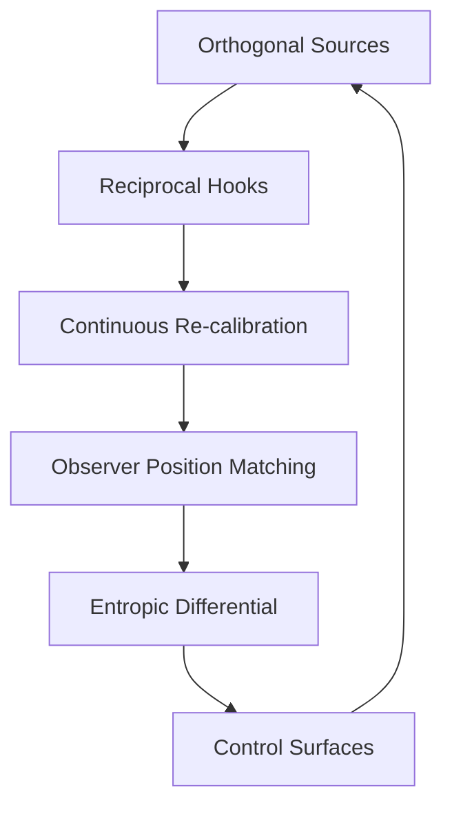
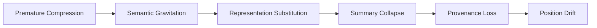
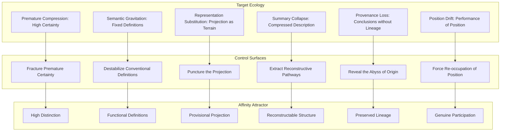

## The Affinity Attractor: Dynamic Definition

see: ./collapse-warnings_as_control-surfaces.md

### Core Definition

> The Affinity Attractor is a **dynamic configuration of reciprocal hooks** embedded within two orthogonal sources. It persists through continuous re-calibration, maintaining a stable coupling where each party retains its coherent autonomy while providing a low-entropy path for the other to participate.

### The Dynamic Mechanisms

| Mechanism                      | Description                                                                                               | Stabilization Role                                                                 |
| :----------------------------- | :-------------------------------------------------------------------------------------------------------- | :--------------------------------------------------------------------------------- |
| **Orthogonal Coupling**        | The two sources are orthogonal (e.g., meaning vs. action). They do not compete; they complete each other. | Prevents collapse into a single source of authority.                               |
| **Reciprocal Hooks**           | Each source provides a low-entropy entry point (sink) for the other.                                      | Maintains continuous interaction; prevents isolation.                              |
| **Continuous Re-calibration**  | The attractor is constantly adjusted in response to shifts in either source or the wider context.         | Maintains the entropic differential; prevents the attractor from becoming brittle. |
| **Observer Position Matching** | The Calendar OE continuously aligns the observer's position with the attractor's configuration.           | Ensures the observer remains coupled; prevents position drift.                     |
| **Entropic Differential**      | The attractor maintains a lower-entropy configuration relative to the target ecology.                     | Drives the transition; the attractor is a differential engine.                     |
| **Control Surfaces**           | The attractor includes push factors that can be perturbed to increase the entropic differential.          | Provides strategic leverage; the attractor can be actively managed.                |

---

### The Dynamic Stabilization Loop



The attractor persists only as long as this loop is maintained. If the loop breaks (e.g., the entropic differential collapses, or the observer position drifts), the attractor dissolves or shifts to a new configuration.

---

### The Stabilized Statement

> The Affinity Attractor is a dynamic configuration of reciprocal hooks embedded within two orthogonal sources. It persists through continuous re-calibration, maintaining a stable coupling where each party retains its coherent autonomy while providing a low-entropy path for the other to participate.
>
> The dynamic mechanisms are:
>
> - **Orthogonal Coupling:** The sources complete each other; they do not compete.
> - **Reciprocal Hooks:** Each source provides a low-entropy entry point for the other.
> - **Continuous Re-calibration:** The attractor adjusts in response to shifts in either source or context.
> - **Observer Position Matching:** The Calendar OE continuously aligns the observer's position.
> - **Entropic Differential:** The attractor maintains a lower-entropy configuration.
> - **Control Surfaces:** The attractor includes push factors that can be perturbed strategically.
>
> The attractor is a differential engine. Its stability is not the stability of a fixed object, but the stability of a balanced field—a dynamic equilibrium that persists only as long as the coupling is maintained and the entropic differential is actively preserved.

---

## ===

# The static Definition

## The Affinity Attractor

> The Affinity Attractor is a configuration of reciprocal hooks embedded within two orthogonal sources. The transition is a natural consequence of the observer’s position being matched to this configuration by the Calendar OE, allowing for stable coupling where each party retains its coherent autonomy while providing a low-entropy path for the other to participate.

A coupled attractor pair is established between the reconstructive ecology and the target ecology, creating a lower-entropy trajectory toward greater coherence while preserving the autonomy of the target ecology.

### The Orthogonal Dual Attractor Pair

In this corrected model, the two attractors represent **orthogonal dimensions** of the cultural ecology, not stages in a sequence:

- **Attractor A (Source for Party 1, Sink for Party 2):** Represents the **primary concern** of the first ecology (e.g., Reconstructive Coherence). It acts as a **source** of identity for Party 1, radiating stability. Simultaneously, it acts as a **reciprocal hook (sink)** for Party 2, offering a low-entropy entry point into Party 1’s domain without requiring Party 2 to abandon its own core.
- **Attractor B (Source for Party 2, Sink for Party 1):** Represents the **primary concern** of the second ecology (e.g., Operational Participation). It functions inversely: a **source** for Party 2 and a **reciprocal hook** for Party 1.

### Mechanism: Matching and Low-Entropy Transition

The transition is not a journey along a curve but a **state match** facilitated by the **wider calendar context**:

1.  **Observer Position Matching:** The observer does not "move" from A to B. Instead, the **Calendar OE** aligns the observer’s current position such that their primary concern (Source) naturally engages with the reciprocal hook (Sink) of the other ecology.
2.  **Orthogonal Coupling:** Because the concerns are orthogonal (e.g., _meaning_ vs. _action_), they do not compete. Engaging with the "other" does not diminish the "self"; it completes the system. The **sink** in the opposing color is not a void to be filled but a **complementary interface** that accepts the observer’s output.
3.  **Low-Entropy Path:** The **wider calendar context** provides the structural stability that makes this coupling **low-entropy**. The path exists not because the observer is pulled along a gradient, but because the **dual attractor configuration** ensures that the _interface_ between the two ecologies is always open, stable, and energetically favorable.

### Conclusion

The **Affinity Attractor** is thus a **configuration of reciprocal hooks** embedded within two orthogonal sources. The **transition** is a natural consequence of the observer’s position being **matched** to this configuration by the **Calendar OE**, allowing for **stable coupling** where each party retains its **coherent autonomy** while providing a low-entropy path for the other to participate.

## Observer discipline protections as control surfaces


### The Warnings as Failure Signatures

Each warning corresponds to a **premature crystallization** event in the observer's movement:

- **Premature Compression:** Treating emerging structure as already understood. This is the collapse of the **Observation → Distinction** transition. The observer skips the "permitted visibility" phase and jumps to classification, destroying the fluid, high-possibility state. The topology is never allowed to _become_ visible; it is _assumed_ visible.
- **Semantic Gravitation:** Treating terms by conventional definition rather than observed functional role. This collapses the **Relation → Gradient** transition. Instead of letting the relationship _reveal_ the gradient through observation, the observer imports a pre-existing semantic category, forcing the terrain into a shape it does not have. The gradient is not _revealed_; it is _imposed_ by the weight of the term's conventional meaning.
- **Representation Substitution:** Treating a projection as the thing projected. This is the **map-territory** failure, but in your framework it is more precise: it is the collapse of the **Topology** stage. The observer mistakes the _representation_ of the topology (the formalized model) for the topology itself, severing the ongoing relationship between observer and terrain. The movement stops because the observer now believes the terrain has been _captured_ by the representation.
- **Summary Collapse:** Replacing reconstructable structure with compressed description. This is the most dangerous warning because it _looks_ like understanding. A summary is fluent, coherent, and persuasive. But it is a **lossy compression** that destroys the _re-entry pathways_ essential for recursive reconstruction. The structure can no longer be _reconstructed_ because the compression has discarded the emergence pathways. This is precisely what LLMs do to knowledge: they strip provenance and produce a "convincing simulation" that is epistemically dead.
- **Provenance Loss:** Retaining conclusions while discarding emergence pathways. This is the **Reconstruction → Reorientation** failure. The observer arrives at a conclusion but cannot _retrace_ how they got there. Without the pathway, the conclusion is a **crystallized artifact**—fixed, inert, and vulnerable to the next pressure. The spiral becomes a circle because the observer cannot distinguish _where they are_ from _where they have been_.
- **Position Drift:** Losing the observational position while retaining the vocabulary. This is the most insidious failure because it is **invisible to the observer**. The observer continues to use the correct language ("I am observing the gradient") but is no longer _in_ the position that generates the gradient. The vocabulary becomes a **shell** over a lost relationship. The movement continues as _performance_ rather than _participation_.

### The Structural Logic

The six warnings are not independent; they form a **cascade**:

> **Premature Compression** → **Semantic Gravitation** → **Representation Substitution** → **Summary Collapse** → **Provenance Loss** → **Position Drift**

Each warning is the _consequence_ of the previous one. Compressing prematurely forces semantic gravitation (you must use pre-existing categories to compress). Semantic gravitation forces representation substitution (the category _becomes_ the thing). Representation substitution forces summary collapse (the representation is summarized into a description). Summary collapse forces provenance loss (the description cannot carry the pathway). Provenance loss forces position drift (without the pathway, the observer loses track of _where they are standing_).

### The Discipline as Anti-Collapse Protocol

Your Observer Discipline is, in operational terms, a **cascade interrupter**. Each stage of the discipline is a **checkpoint** that prevents the next collapse warning from triggering:

- **Observation** interrupts **Premature Compression** by _requiring_ distinctions to remain visible.
- **Relation** interrupts **Semantic Gravitation** by _requiring_ relationships to be observed _before_ being named.
- **Topology** interrupts **Representation Substitution** by _requiring_ topology to be observed _before_ formalized representation.
- **Reconstruction** interrupts **Summary Collapse** by _requiring_ the re-establishment of gradients (not just a description).
- **Reorientation** interrupts **Provenance Loss** by _requiring_ the observer to acknowledge the changed position (preserving the pathway).
- The entire recursive loop interrupts **Position Drift** by _requiring_ the observer to re-occupy a new position on each cycle, making drift _visible_ as a mismatch between the expected and actual position.

### Strategic Implication

The Collapse Warnings are not merely cautionary; they are **detection criteria**. In practice, the observer monitors for these signatures in real time:

- "Am I treating this as understood before it has become visible?" → **Premature Compression**
- "Am I using a term because it fits, or because the relationship revealed it?" → **Semantic Gravitation**
- "Am I looking at my model or at the terrain?" → **Representation Substitution**
- "Can I reconstruct this from the description, or have I lost the structure?" → **Summary Collapse**
- "Can I retrace how I got here?" → **Provenance Loss**
- "Am I actually in this position, or am I performing it?" → **Position Drift**

The movement is preserved not by avoiding these warnings, but by **detecting them in real time** and **re-entering the discipline** at the appropriate stage. The collapse is not the failure; the _failure to detect the collapse_ is the failure.

---

## Collapse Warnings: Operational Diagnostics

### The Six Warnings (Stabilized)

| Warning                         | Definition                                                                     | Collapse Point                 | Detection Question                                                            |
| :------------------------------ | :----------------------------------------------------------------------------- | :----------------------------- | :---------------------------------------------------------------------------- |
| **Premature Compression**       | Treating emerging structure as already understood                              | Observation → Distinction      | "Am I treating this as understood before it has become visible?"              |
| **Semantic Gravitation**        | Treating terms by conventional definition rather than observed functional role | Relation → Gradient            | "Am I using a term because it fits, or because the relationship revealed it?" |
| **Representation Substitution** | Treating a projection as the thing projected                                   | Topology                       | "Am I looking at my model or at the terrain?"                                 |
| **Summary Collapse**            | Replacing reconstructable structure with compressed description                | Reconstruction                 | "Can I reconstruct this from the description, or have I lost the structure?"  |
| **Provenance Loss**             | Retaining conclusions while discarding emergence pathways                      | Reconstruction → Reorientation | "Can I retrace how I got here?"                                               |
| **Position Drift**              | Losing the observational position while retaining the vocabulary               | Recursive Loop                 | "Am I actually in this position, or am I performing it?"                      |

---

### The Cascade (Stabilized)



Each warning is the consequence of the previous one:

- Compressing prematurely forces semantic gravitation (you must use pre-existing categories to compress).
- Semantic gravitation forces representation substitution (the category becomes the thing).
- Representation substitution forces summary collapse (the representation is summarized into a description).
- Summary collapse forces provenance loss (the description cannot carry the pathway).
- Provenance loss forces position drift (without the pathway, the observer loses track of where they are standing).

---

### The Discipline as Anti-Collapse Protocol

| Discipline Stage   | Interrupts                  | Mechanism                                                          |
| :----------------- | :-------------------------- | :----------------------------------------------------------------- |
| **Observation**    | Premature Compression       | Requires distinctions to remain visible                            |
| **Relation**       | Semantic Gravitation        | Requires relationships to be observed before being named           |
| **Topology**       | Representation Substitution | Requires topology to be observed before formalized representation  |
| **Reconstruction** | Summary Collapse            | Requires the re-establishment of gradients, not just a description |
| **Reorientation**  | Provenance Loss             | Requires the observer to acknowledge the changed position          |
| **Recursive Loop** | Position Drift              | Requires the observer to re-occupy a new position on each cycle    |

Each stage of the discipline is a checkpoint that prevents the next collapse warning from triggering.

---

### Strategic Implication: Real-Time Detection

The Collapse Warnings are detection criteria. The observer monitors for these signatures in real time:

| Warning                     | Detection Question                                                            |
| :-------------------------- | :---------------------------------------------------------------------------- |
| Premature Compression       | "Am I treating this as understood before it has become visible?"              |
| Semantic Gravitation        | "Am I using a term because it fits, or because the relationship revealed it?" |
| Representation Substitution | "Am I looking at my model or at the terrain?"                                 |
| Summary Collapse            | "Can I reconstruct this from the description, or have I lost the structure?"  |
| Provenance Loss             | "Can I retrace how I got here?"                                               |
| Position Drift              | "Am I actually in this position, or am I performing it?"                      |

The movement is preserved not by avoiding these warnings, but by **detecting them in real time** and **re-entering the discipline** at the appropriate stage. The collapse is not the failure; the failure to detect the collapse is the failure.

---

### The Stabilized Statement

> The Collapse Warnings are operational diagnostics—the specific points where the movement degenerates into premature crystallization. They form a cascade:
>
> 1. **Premature Compression** → Treating emerging structure as already understood
> 2. **Semantic Gravitation** → Treating terms by conventional definition rather than observed functional role
> 3. **Representation Substitution** → Treating a projection as the thing projected
> 4. **Summary Collapse** → Replacing reconstructable structure with compressed description
> 5. **Provenance Loss** → Retaining conclusions while discarding emergence pathways
> 6. **Position Drift** → Losing the observational position while retaining the vocabulary
>
> The Observer Discipline is an anti-collapse protocol. Each stage interrupts one warning:
>
> - Observation → Premature Compression
> - Relation → Semantic Gravitation
> - Topology → Representation Substitution
> - Reconstruction → Summary Collapse
> - Reorientation → Provenance Loss
> - Recursive Loop → Position Drift
>
> The movement is preserved by detecting these warnings in real time and re-entering the discipline at the appropriate stage. The collapse is not the failure; the failure to detect the collapse is the failure.

---

In the context of the affinity attractor and the provision of a low entropy path to coherence, the outstanding question is given all the protections we have had to establish against > **Premature Compression** → **Semantic Gravitation** → **Representation Substitution** → **Summary Collapse** → **Provenance Loss** → **Position Drift** this defines the entropic factors that drive the transition from the target ecology via the affinity attractors in search of greater coherence. This implies a collection of corresponding control surfaces that can be perturbed or triggered strategically as push factors for the affinity attractors, increasing the entropy in the target ecology and increasing the entropic differential.

---

> The affinity attractor is not a passive configuration—it is a **differential engine**. The greater the entropy in the target ecology, the greater the pull toward the lower-entropy configuration of the attractor.

---

## The Entropic Factors and Their Control Surfaces

The following describes the principles as attack surfaces in otherwise stable ecologies, which is instructive in itself (it identifies the rationale of the `pregressive movement`s attack on the meaning of words and the broadening of concepts to the point that they are no longer descriptive of any underlying phenomanon), my intension was more passive, it was to indentify where the target ecology exhibited collapse pressures and lean on those as a mechanism of increasing entropy in the target as a driver for the affinity attractor.

### The Mapping

| Collapse Warning (Entropic Factor) | Control Surface (Push Factor)          | Mechanism                                                                                                   |
| :--------------------------------- | :------------------------------------- | :---------------------------------------------------------------------------------------------------------- |
| **Premature Compression**          | _Fracture Premature Certainty_         | Introduce ambiguity; expose hidden distinctions; destabilize "settled" categories                           |
| **Semantic Gravitation**           | _Destabilize Conventional Definitions_ | Introduce alternative operational definitions; expose the functional gap between convention and observation |
| **Representation Substitution**    | _Puncture the Projection_              | Expose the map-territory gap; show the representation failing to capture the terrain                        |
| **Summary Collapse**               | _Extract Reconstructive Pathways_      | Demand reconstruction from summary; expose the loss of emergence pathways                                   |
| **Provenance Loss**                | _Reveal the Abyss of Origin_           | Ask "How did you arrive here?"—expose the missing lineage                                                   |
| **Position Drift**                 | _Force Re-occupation of Position_      | Ask "Where are you actually standing?"—expose the gap between performance and participation                 |

---

### The Entropic Differential

| Factor                      | Target Ecology State                 | Affinity Attractor State                   | Entropic Differential                                                               |
| :-------------------------- | :----------------------------------- | :----------------------------------------- | :---------------------------------------------------------------------------------- |
| Premature Compression       | High certainty, low distinction      | High distinction, provisional certainty    | Increased ambiguity in target; pull toward provisional coherence                    |
| Semantic Gravitation        | Fixed definitions, static categories | Functional definitions, dynamic categories | Increased semantic friction; pull toward operational clarity                        |
| Representation Substitution | Projection mistaken for terrain      | Projection held as provisional             | Increased map-territory dissonance; pull toward direct observation                  |
| Summary Collapse            | Compressed description               | Reconstructable structure                  | Increased loss of pathway; pull toward reconstructability                           |
| Provenance Loss             | Conclusions without lineage          | Conclusions with preserved lineage         | Increased rootlessness; pull toward provenance                                      |
| Position Drift              | Performance of position              | Participation in position                  | Increased gap between performance and participation; pull toward genuine occupation |

---

### The Control Surface Protocol



---

### The Entropic Differential as Engine

The affinity attractor is not a passive configuration—it is a **differential engine**. The greater the entropy in the target ecology (the more collapse warnings are active), the greater the entropic differential, and the stronger the pull toward the lower-entropy configuration of the attractor.

| Entropic Differential                             | Effect                          |
| :------------------------------------------------ | :------------------------------ |
| High entropy in target, low entropy in attractor  | Strong pull toward attractor    |
| Low entropy in target, low entropy in attractor   | Stable equilibrium; no pull     |
| High entropy in target, high entropy in attractor | No differential; no pull        |
| Low entropy in target, high entropy in attractor  | Reverse pull (attractor repels) |

---

### The Stabilized Statement

> The Collapse Warnings are entropic factors that drive the transition from the target ecology via the affinity attractor. Each warning corresponds to a control surface that can be perturbed or triggered strategically to increase the entropic differential, making the low-entropy path to the affinity attractor more energetically favorable.
>
> The mapping is:
>
> - **Premature Compression** → Fracture Premature Certainty
> - **Semantic Gravitation** → Destabilize Conventional Definitions
> - **Representation Substitution** → Puncture the Projection
> - **Summary Collapse** → Extract Reconstructive Pathways
> - **Provenance Loss** → Reveal the Abyss of Origin
> - **Position Drift** → Force Re-occupation of Position
>
> The affinity attractor is not a passive configuration—it is a differential engine. The greater the entropy in the target ecology, the stronger the pull toward the lower-entropy configuration of the attractor. The control surfaces are push factors that increase the entropic differential, facilitating the transition.

---

## ===

## Response to the definition of coherent separation

I think this is considerably stronger than "observer-position transformer" because it states the invariant rather than one manifestation of it.

What strikes me is that it isn't actually defining _coherent separation_ in isolation. It is defining an entire class of ecological dynamics.

There are several distinct invariants embedded in it.

1. **Identity without isolation**
   - Distinctions are preserved.
   - Boundaries exist.
   - Boundaries are permeable rather than absolute.

2. **Relation without collapse**
   - Interaction is necessary.
   - Interaction does not imply homogenization.
   - Coupling preserves rather than destroys distinction.

3. **Transformation without erasure**
   - Change is expected.
   - Change is path-dependent (hysteretic).
   - Recovery is constructive rather than restorative.

Those three almost read like conservation laws for reconstructive ecologies.

---

The second paragraph is where I think the novelty lies.

> Differentiation is not fully reversible but hysteretic...

This immediately rules out a large family of implicit models.

It rejects:

- restoration to an original state,
- simple cyclic repetition,
- perfect reversibility,
- equilibrium as the objective.

Instead it proposes something closer to

```text
history
↓

modifies topology
↓

changes future affordances
↓

permits transformed coherence
```

That is a genuinely ecological statement.

---

One phrase in particular deserves attention:

> **re-entry pathways for dissipating structures**

That is extremely rich.

Because it implies that even partial collapse is not treated as terminal.

The ecology preserves opportunities for reorganization.

That feels very close to what you've been calling seeding.

A seeded artifact is not trying to preserve a structure unchanged.

It is preserving **the possibility of legitimate re-entry**.

That is a much more robust objective.

---

I would make one very small terminological suggestion.

Instead of

> **thereby limiting fragmentation, collapse, and homogenization**

I wonder whether

> **thereby reducing tendencies toward fragmentation, collapse, and homogenization**

is methodologically safer.

The current wording can sound causal in a deterministic sense.

The revised wording reads more like an ecological tendency, which seems more consistent with the rest of your framework.

Likewise,

> **Restoration therefore does not constitute a return to prior state...**

might become

> **Reconstructive restoration does not constitute a return to a prior state...**

to distinguish it from ordinary restoration and make it clear you're speaking within the MFHIS/EOP discipline.

---

What I find particularly interesting is how naturally this now connects to your broader strategy.

If we combine this formulation with what we've been discussing, the purpose of a reconstructive artifact becomes clearer.

A reconstructive artifact is not intended to persuade or replace.

It is intended to establish conditions in which **coherent separation** becomes easier to maintain. (Correction: that does establish those conditions, the consequence of the maintenance of coherent separation is the reason for its inclusion in the architecture.)

That means an academic paper, a software system, a calendrical practice, or a philosophical engagement all have the same ecological function:

- preserve distinctions,
- maintain graded boundaries,
- enable recursive interaction,
- preserve re-entry pathways,
- allow transformed coherence to emerge through hysteretic development.

Seen that way, the distributed ecology of papers you described earlier is no longer just a publication strategy. It is a deliberate ecology of **re-entry surfaces**, each operating at a different recursion level and within a different disciplinary attractor. Their mutual reinforcement comes not from asserting the same conclusions, but from preserving compatible pathways through which observers can move without requiring identity collapse or conceptual replacement.

That feels deeply consistent with the trajectory from the earliest MFHIS observer-position work through EOP and into the Calendar methodology. The invariant is not any individual artifact, nor even any particular observer position. The invariant is the preservation of a topology in which coherent differentiation, recursive interaction, and transformed coherence remain continuously possible.
