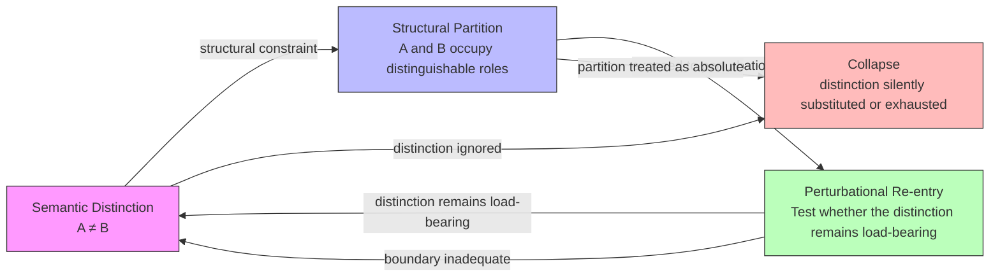
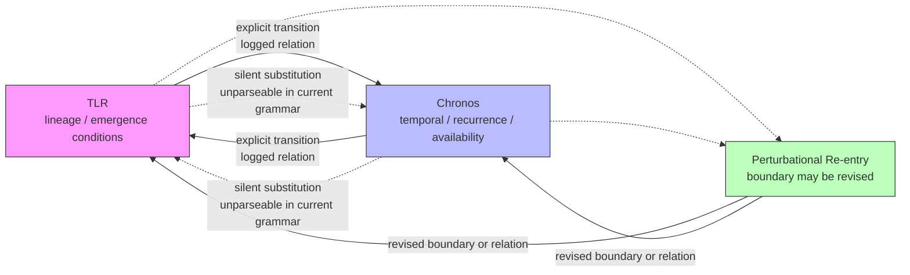
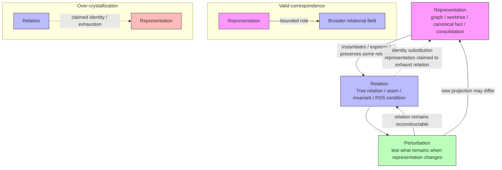
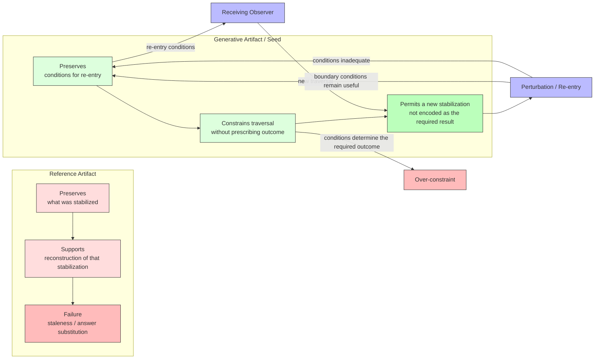
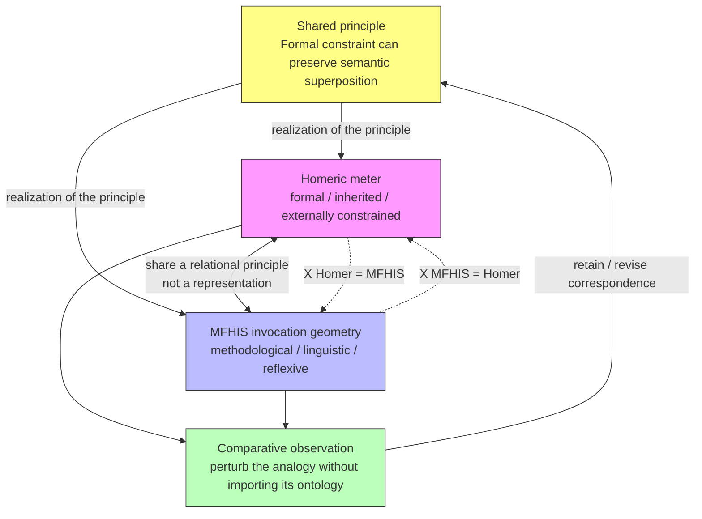
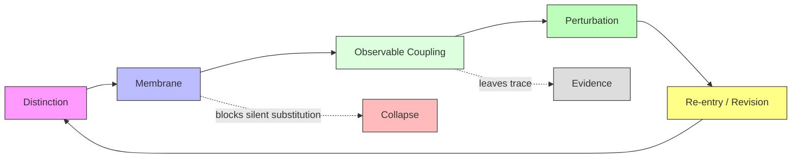

Yes. I would revise them so the diagrams preserve the synthesis we've reached without making the diagrams themselves over-crystallize it. In particular:

- **collapse is a failure state**, not a normal recursive destination;
- **membranes permit coupling but block silent substitution**;
- **representations instantiate relations without exhausting them**;
- **Seeds constrain re-entry without prescribing its outcome**;
- **Homer is a witness to the principle, not an MFHIS instance**;
- and **every boundary remains revisable through perturbation**.

### 1. Three-Tier Anti-Collapse Loop

**Reading:** the three tiers are not a hierarchy. The loop is the system. Semantic distinction provides something to preserve; structural partition makes it operationally visible; perturbational re-entry prevents the partition itself from becoming unquestionable ontology.

---

### 2. Seam as Membrane — Not Wall

**Reading:** the seam does not prohibit coupling. It prohibits **unmarked substitution**. Crossing the membrane is itself an observable event. The membrane can subsequently be revised if perturbation shows that its current partition is inadequate.

---

### 3. Non-Substitutability — Representation → Relation

**Reading:** the representation has a bounded role. The relation is not required to have that particular representation. Perturbing the representation is precisely how the distinction between relation and crystallization becomes observable.

---

### 4. Seed — Generative Rather Than Merely Referential

**Reading:** the Seed does not need to permit contradiction of its own conditions. It needs to preserve conditions that constrain **entry** without predetermining **what stabilization must emerge**. That is the distinction between generative preservation and a reference artifact disguised as a specification.

---

### 5. Homeric Witness — Not Instance

**Reading:** Homer supplies a **witness** to the possibility that formal constraints can maintain multiplicity without relying solely on explicit anti-collapse rules. It does not thereby instantiate MFHIS, nor does MFHIS become an interpretation of Homer.

---

### The common topology

Across all five, the same structural grammar now appears:

I would **not** make this a sixth canonical diagram yet. The five specific diagrams are still doing different observational work. But this common topology is a useful candidate for the synthesis:

> **Distinction is preserved by a membrane; the membrane permits observable coupling; coupling leaves evidence; perturbation tests the boundary; re-entry permits revision.**

And crucially, **none of those stages is the foundation**. The ecology is the loop.
