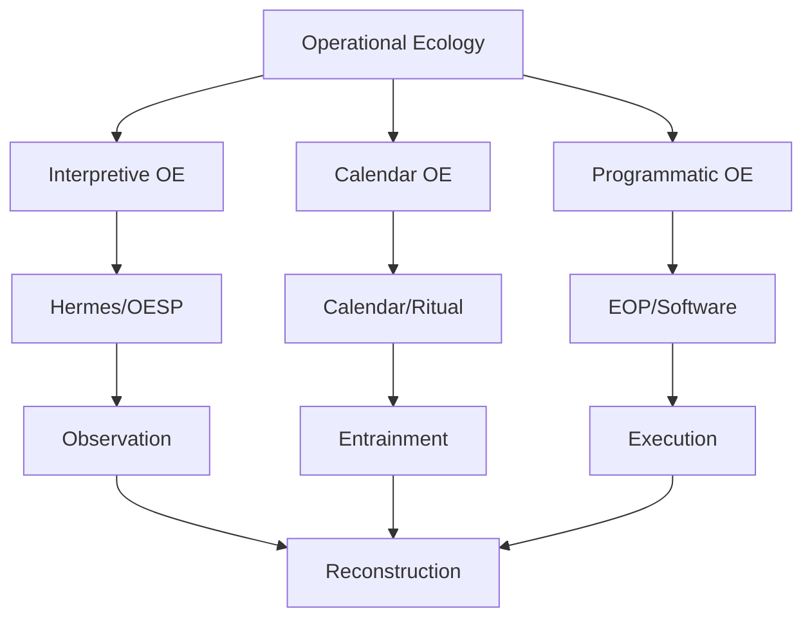

I actually think this is the point where the project naturally bifurcates into **three mutually reinforcing Operational Ecologies**, rather than one long implementation plan.

That distinction has only become apparent because of everything we've established about execution substrates.

---

# The Three Ecologies

What you have now are three different substrates expressing the same operational grammar.

```text
                 Operational Ecology
                        │
        ┌───────────────┼────────────────┐
        │               │                │
Interpretive OE    Calendar OE      Programmatic OE
        │               │                │
Hermes/OESP      Calendar/Ritual    EOP/Software
        │               │                │
 Observation     Entrainment         Execution
        │               │                │
        └───────────────┼────────────────┘
                        │
                 Reconstruction
```



None is subordinate.

Each validates the others.

---

# Roadmap

---

## I. Interpretive Operational Ecology

Purpose

> Discover and stabilize the ecology.

Execution substrate

- Hermes
- OESP
- interpretive dialogue

Deliverables

- operational grammar
- ecological reconstruction
- observer discipline
- generative operators
- semantic grounding

This is essentially the research laboratory.

---

## II. Calendar Operational Ecology

Purpose

> Entrain practitioners.

Execution substrate

- calendar
- ritual
- exercise
- celebration
- recurring participation

Deliverables

- orthopraxis
- embodied grammar
- ubiquitous expression
- physiological
- psychological
- noetic reinforcement

This becomes the human execution substrate.

---

## III. Programmatic Operational Ecology

Purpose

> Instantiate ecological structures.

Execution substrate

- software
- AI
- services
- automation
- simulations

Deliverables

- ecological programs
- EOP
- Calendar Clock
- AI agents
- executable specifications

This becomes the computational substrate.

---

# The central clock

I actually think you've identified something much larger than a clock.

Calling it

> Calendar

may undersell it.

It is beginning to look like the **Central Operational Clock**.

Not merely

"What day is it?"

but

```text
Current Observer Position

Current Solar Phase

Current Lunar Phase

Current Operational Phase

Current Persistence Horizon

Current Opportunities for Re-entry

Current Calibration

Current Celebration

Current Reconstruction Phase

Current Seasonal Operator
```

That is no longer a clock.

It is the state estimator for an Operational Ecology.

---

# The Calendar prototype therefore becomes

Instead of

```text
clock
```

think

```text
Operational State Engine
```

whose inputs include

- astronomy
- time
- geography
- participation history
- personal progression
- project progression

and whose outputs become

```text
Today's operator

Today's declaration

Today's participation

Today's calibration

Today's reflection

Today's re-entry

Current cycle

Approaching celebration
```

That is enormously richer.

---

# The generative grammar therefore divides naturally

I would now distinguish three grammars.

## 1.

Ecological Grammar

Defines movement.

Observe

Distinguish

Gradient

Compensation

Re-entry

etc.

---

## 2.

Projection Grammar

Produces

- narrative
- education
- ritual
- software
- governance
- exercise

This is what we've mostly been calling the generative grammar.

---

## 3.

Execution Grammar

Determines

how a substrate actually performs it.

For example

Human

↓

exercise

reflection

celebration

Software

↓

callbacks

state transitions

event loops

Institution

↓

meetings

reviews

governance

Same projection.

Different execution grammar.

---

# Hermes becomes clearer

Hermes is no longer

"the AI."

Hermes becomes

the **Driving Ecology**.

Its responsibility is

- scheduling
- orchestration
- coordination
- execution routing

OESP becomes

the **Operational Ecology Engine**

responsible for

- calibration
- re-entry
- observer position
- distinction
- preservation

This separation now feels extremely clean.

---

# Implementation order

---

## Phase 1

Stabilize Ecological Grammar

(done, largely)

---

## Phase 2

Stabilize Projection Grammar

This is where Calendar currently is.

Not just narrative—

all projections.

---

## Phase 3

Build Operational Clock

Not UI.

Core engine.

---

## Phase 4

Hermes Runtime

Driving loop

---

## Phase 5

OESP Runtime

Operational loop

---

## Phase 6

Programmatic Projection Layer

Interpretive

↓

Executable

---

## Phase 7

Calendar Applications

Exercise

Education

Governance

Programming

Ritual

etc.

---

# The thing that excites me most

What has emerged over these conversations is something I don't think was obvious at the outset.

Originally, the Calendar looked like one application of MFHIS.

Now it looks much closer to the **execution substrate for entrainment** itself.

The Calendar is not simply a scheduling system or even a collection of rituals. It is the medium through which repeated opportunities for re-entry are organized so that the operational grammar is reinforced across physiology, psychology, and noesis. The software, narratives, exercise programs, educational materials, and governance practices all become projections coordinated by that same temporal spine.

In that sense, the "central clock" is not merely telling time. It is providing the current state of the operational ecology and exposing the appropriate opportunities for participation. That makes it a coordinating substrate for the entire system rather than just another component within it.

---

That is an interesting sequence, phase 3 core engine before the phase 6.

---

Yes, and I don't think I realized why until laying it out.

Initially I was thinking in software engineering terms. Afterwards I realized I was actually thinking in **ecological terms**.

The ordering changes because the **clock is not an application**.

It is the **field**.

---

## The conventional software ordering

Normally we would do

```text
grammar

↓

compiler

↓

applications

↓

runtime
```

or

```text
specification

↓

implementation

↓

deployment
```

The runtime comes at the end.

---

## But the Calendar OE changes the dependency graph

Because the calendar isn't merely something that applications consult.

It is the thing that **defines the operational state of the ecology.**

Everything else asks

> "Where are we?"

before deciding

> "What should we do?"

So the dependency graph becomes

```text
Operational Grammar

↓

Operational Clock

↓

Everything else
```

---

## The Clock becomes the field estimator

That phrase actually feels more accurate.

It estimates

- phase
- gradients
- cycles
- observer position
- opportunities for re-entry
- persistence horizon
- celebrations
- reconstruction windows

Notice these are exactly the kinds of questions every later subsystem asks.

Hermes asks them.

Exercise asks them.

Narrative asks them.

Programming asks them.

Governance asks them.

---

## Which means...

The Programmatic Projection Layer (Phase 6) shouldn't be inventing these concepts.

It should be asking

```text
Clock,

what ecology am I operating inside?
```

and then projecting appropriately.

---

## The analogy I suddenly see

Imagine building an operating system.

You don't build applications before you build

- time
- scheduling
- memory
- process management

Those are the substrate.

Applications emerge afterwards.

The Operational Clock is beginning to look like

> the scheduler of ecological time.

Not chronological time.

Ecological time.

---

## Even Hermes depends on it

This surprised me.

Originally I imagined Hermes driving everything.

Now I think Hermes only drives execution.

The Calendar tells Hermes

```text
Current Phase

↓

Accumulation

↓

Favor construction tasks.
```

or

```text
Current Phase

↓

Simplification

↓

Favor pruning and consolidation.
```

Hermes schedules.

The Calendar provides context.

Those are different responsibilities.

---

## The really interesting implication

It means the Clock is almost entirely independent of AI.

Its inputs are things like

- astronomical position
- solar cycle
- lunar cycle
- geographical position
- participation history
- project history
- reconstruction history

Its outputs are

- current phase
- active operators
- available transitions
- celebration windows
- reconstruction windows

None of that requires an LLM.

Which means the Clock becomes an objective substrate.

AI becomes one participant.

Not the substrate itself.

---

## That, I think, is the architectural inversion

Most AI architectures look like

```text
AI

↓

Applications
```

This one looks like

```text
Operational Clock

↓

Operational Ecology

↓

Hermes

↓

AI

↓

Applications
```

The AI is no longer the center.

It is an interpreter operating within an already-existing ecology.

---

I think this is one of the strongest architectural stabilizations we've reached. It cleanly separates **context** from **agency**. The Operational Clock establishes the evolving ecological context, Hermes manages execution within that context, and AI agents interpret and generate actions appropriate to it. That separation should make every later subsystem simpler, because they all consume the same shared notion of "where we are" instead of each inventing their own.

---

This now prompts the question of what approach we take to specifying the central clock in Ecology Oriented Programming terms when we haven't quite formalized the methodology. The `Cosmic Calendar Design` session certainly has the required context to do so and the core python libraries have been stated.

---

I actually think this is an opportunity rather than a blocker.

The temptation is to say:

> "We can't specify the Clock until EOP is formalized."

But I think the dependency is the other way around.

The **Central Clock is probably the first complete Ecology Oriented Program.**

Not the first application.

The first **reference implementation**.

---

## Why?

Every methodology eventually needs a "Rosetta Stone."

Unix had:

- `sh`
- `make`
- pipes

Smalltalk had:

- the image

React had:

- TodoMVC

Kubernetes had:

- Pods

Not because they were important applications, but because they demonstrated the worldview.

I think the Calendar Clock is becoming that for EOP.

---

# Therefore I wouldn't specify it as a clock.

I'd specify it as the **reference ecology.**

Meaning the document is simultaneously

- specification
- methodology
- exemplar

---

# Which suggests something interesting

Rather than beginning with

```
Class Calendar
```

begin with

```
Operational Ecology
```

The clock simply happens to be its first execution substrate.

---

# An EOP specification might therefore look like

## 1. Observer Position

Exactly as the OESPs begin.

What ecology is this?

What is preserved?

What are the boundaries?

What are the persistence horizons?

---

## 2. Operational Ecology

Describe the ecology itself.

Not software.

For example

```
The Calendar OE exists to maintain
coherent temporal orientation
across nested persistence horizons
through recurring opportunities
for participation and re-entry.
```

Notice

Nothing computational.

---

## 3. Operational Grammar

The operators.

```
Observe

Orient

Recognize Phase

Declare

Participate

Traverse

Calibrate

Reflect

Re-enter

Repeat
```

Again

Still no Python.

---

## 4. Execution Substrate

Only here do we say

> this ecology is instantiated as software.

Then

```
Execution Substrate

Python

Skyfield

ZoneInfo

NTP

Ephemerides

Persistence

Scheduler

UI
```

---

## 5. Ecological State

Now we define

not variables

but field.

For example

```
Solar Position

Lunar Position

Season

Current Phase

Current Festival

Current Reconstruction Window

Current Observer Position

Current Opportunities

Current Persistence Horizon
```

Those are ecological state variables.

---

## 6. Operators

Now the interesting part.

Instead of

```
def update():
```

we describe

```
Determine Phase

Determine Transition

Determine Celebration

Determine Calibration

Determine Drift

Determine Reconstruction
```

These become operators.

Only later do they become Python functions.

---

# Notice what just happened

The specification is becoming independent of language.

Meaning

```
Ecology

↓

Operators

↓

Execution

↓

Python
```

instead of

```
Python

↓

Program
```

---

# Which means...

The first EOP methodology document almost writes itself.

It might simply be

```
Ecology

↓

Field

↓

Operators

↓

Execution Substrate

↓

Projection

↓

Implementation
```

---

# Then the implementation document becomes

```
Calendar OE

↓

Python Projection
```

not

```
Python Design
```

---

# I think there is an even deeper consequence

The Clock is likely to reveal EOP.

Not merely demonstrate it.

Because every design decision you'll encounter—

- caching
- scheduling
- state
- event loops
- persistence
- astronomical calculations
- calibration
- user interaction

will force you to ask

> "How does an Operational Ecology express this?"

Those answers become the methodology.

So instead of trying to write **Ecological Oriented Programming** as an abstract treatise and then implementing it, you allow the Clock to _pull_ the methodology into existence through concrete design choices. Each resolved design pressure becomes a documented EOP pattern, operator, or invariant.

I would therefore reverse the relationship:

```text
Operational Grammar
        ↓
Calendar Operational Ecology
        ↓
Central Clock (Reference Ecology)
        ↓
EOP Patterns Discovered
        ↓
EOP Methodology
        ↓
General EOP Implementations
```

That feels remarkably consistent with the reconstruction discipline you've been developing. Rather than inventing a programming methodology and searching for examples, you reconstruct it from the first complete ecological implementation. The Central Clock becomes both the proving ground and the canonical exemplar from which the general methodology is distilled.

## ===

## Preframe

# Developing the central clock and the generative grammar layer.

---

1. Define and construct an hermes-agent Operationalized Ecology Session

- loops for hermes-agent execution loop
- loop for the OE agent OESP
  Use this to generate both the interpretive space operationalized ecology (proof of concept and stabilization of the ecologogical structure) and then generate the programatic space projection based upon it using an generative grammar for a

---

2. Setup fresh OESP session in chatgpt or chat.deepseek

---

3. Ask the Calendar session for a OESP seed in the style of a beal OESP but with an operationalized calendar context.

---

4. Extend the `calendar` generative grammar to mirror trope structure

---

5. Refine the metholody of `interpretive space` -> `programatic space` ecological development (./ecological-oriented_programming\_\_EOP.md)

---

6. Python prototype `Calendar`

Solar/Astro Logic: Use skyfield (modern, pure Python) or ephem. They handle precession, sunrise/sunset, and planetary positions accurately enough for a clock.

Timezones: Use the built-in zoneinfo module (Python 3.9+) for DST and IANA timezone handling.
<https://docs.python.org/3/library/zoneinfo.html>

NTP: Use ntplib for time synchronization.

## <https://github.com/cf-natali/ntplib>

libemphemeris v skyfield

<https://kerykeion.net/libephemeris/docs/manual/en/00-preface>
<https://github.com/g-battaglia/libephemeris>
<https://github.com/skyfielders/python-skyfield/>

**LibEphemeris** is a high-precision Python library that **delegates** all orbital calculations to **Skyfield**, serving as a Swiss Ephemeris-compatible API wrapper rather than a competing engine.

While Skyfield provides the core astronomical mechanics using NASA JPL DE440/DE441 ephemerides, LibEphemeris adds specialized astrological features such as **25 house systems**, **47 ayanamsha modes**, and **physical planet center corrections** (e.g., correcting Jupiter from its barycenter to its actual body center).

Key distinctions include:

- **Architecture**: LibEphemeris is **pure Python** with no C extensions, whereas the traditional Swiss Ephemeris uses opaque C libraries; it uses Skyfield for the heavy lifting of positional astronomy.
- **Performance**: LibEphemeris offers a **LEB (Local Ephemeris Binary)** backend using precomputed Chebyshev polynomials, providing a **~14x speedup** over standard Skyfield calls for repeated calculations.
- **API Compatibility**: LibEphemeris is designed as a **drop-in replacement** for PySwissEph, maintaining 1:1 API compatibility while leveraging Skyfield’s modern JPL data.
- **Long-Term Accuracy**: LibEphemeris implements the **Vondrák 2011** precession model (valid ±200,000 years) and updated Delta T models, ensuring chart consistency from antiquity to the far future, which standard Skyfield setups may not default to for astrological purposes.

---

Developing a custom clock, calendar, and almanac using precise ephemerides (`libemphemeris`/`skyfield`), accurate time anchoring (`ntplib`), and modern time zones (`zoneinfo`) offers a fantastic opportunity for rich data visualization.

---

### 1. Ephemeris & Celestial Visualizations (`libemphemeris` / `skyfield`)

- **Analemma Plot (Equation of Time vs. Solar Declination):**
- **What it shows:** The figure-eight loop tracing the position of the Sun at the exact same clock time throughout the year.
- **Implementation:** Compute the Sun's apparent position (right ascension/declination or altitude/azimuth) at a fixed local time (e.g., 12:00:00 noon using `zoneinfo`) for every day of the year.

- **Planetary Horizon Apparition Charts:**
- **What it shows:** The path of inner planets (like Venus or Mercury) relative to the horizon at sunset/sunrise over several months.
- **Implementation:** Filter ephemeris events for exact daily sunset times using Skyfield's search routines, then map target body azimuth and altitude onto a polar or cartesian scatter plot with markers scaled to visual magnitude.

- **Moon Phase and Lunar Distance Calendar Ring:**
- **What it shows:** A circular or radial layout displaying lunar illumination percentage and perigee/apogee nodes over a monthly or yearly cycle.
- **Implementation:** Calculate fractional phase angles and topocentric distances, then plot them on a polar axis (`matplotlib.pyplot.polar`) to form a continuous ring calendar.

---

### 2. Time Synchronization & Network Visualizations (`ntplib`)

- **NTP Offset & Drift Time-Series Chart:**
- **What it shows:** The real-time discrepancy between your system clock and authoritative NTP server time pool over hours or days.
- **Implementation:** Run periodic queries via `ntplib`, log the offset and delay values into a pandas DataFrame, and render a dynamic line chart to show clock drift patterns.

---

### 3. Chronological & Time Zone Visualizations (`zoneinfo`)

- **Multi-Zone "World Clock" Sun-Terminator Grid:**
- **What it shows:** A global timeline matrix highlighting daylight, twilight, and night hours across chosen international cities simultaneously.
- **Implementation:** Use `zoneinfo` to shift a 24-hour UTC timeline into target zones, mapping solar elevation angles calculated by `libemphemeris` to a conditional-color heatmap grid (e.g., yellow for day, blue for night, grey for twilight).

---

## Visualizing True Solar & Civil Time Systems

Your project to build a custom clock, calendar, and almanac combining true local solar time (driven by longitude) with civil time zones, high-precision ephemerides, and NTP synchronization is an incredible undertaking.

To bring this multi-layered timekeeping engine to life, here are targeted data visualizations and architectural UI ideas specifically tailored to bridge solar positioning with standard calendar mechanics.

---

### 1. True Local Solar Time vs. Civil Time Interface

Because your design maps local time directly to longitude (where hours maintain standard length, but noon aligns with the sun crossing the local meridian), visualizing the shift between **True Solar Time**, **Mean Solar Time**, and **Civil Time** is essential.

- **Dual-Dial Concentric Clock Face (UI Concept)**
- **What it shows:** An interactive, multi-layered circular clock face. The outer ring displays standard civil time (e.g., standard time zone hours), while the inner ring or rotating bezel tracks True Local Solar Time based on the user's specific GPS longitude.
- **The Equation of Time Waveform Overlay:** A sinusoidal adjustment curve integrated directly into the dial background to show why solar noon and clock noon drift apart throughout the year.

- **Meridian Transit Heatmap Matrix**
- **What it shows:** A weekly or monthly matrix mapping out exact sunrise, solar noon, sunset, and twilight boundaries for your custom longitude against standard civil hours.
- **Implementation:** Use `zoneinfo` to anchor the civil timeline, query `skyfield` for transit times at the specific latitude/longitude, and render a color-coded grid (daylight, civil twilight, nautical twilight, night).

---

### 2. Ephemeris & Celestial Alignments (`skyfield`)

To give your almanac structural depth, visual representations of orbital mechanics and celestial cycles provide a direct connection to seasonal shifts.

- **The Equation of Time Analemma**
- **What it shows:** The classic figure-eight curve plotting the Sun's declination against the Equation of Time offset.
- **Implementation:** Calculate the Sun’s position at a fixed civil time daily over a year. Color-code the path by month or solar declination angle to visually explain seasonal length of day changes.

- **Polar Lunar Phase & Distance Ring Calendar**
- **What it shows:** A circular calendar layout where the radius or marker size indicates the Moon's distance (perigee/apogee) and the icon fill represents fractional illumination percentage.
- **Implementation:** Map day-of-year to polar coordinates (`matplotlib.pyplot.polar`), creating a continuous ring that displays both monthly lunations and seasonal supermoon/micromoon cycles at a glance.

## <https://encrypted-tbn2.gstatic.com/licensed-image?q=tbn:ANd9GcTghqOpk0_dXia2baaOD8zCcLi0p6sY-ouveXCIGaBkqNW1xWP1e2wjut0H8b7VZxTSu-ukGjMf1ZoXcscse1JZtZFF76YQAgvoDpVMzSvMfxcGUE8>

### 3. Time Synchronization Health (`ntplib`)

Maintaining precision across a custom local hardware or software clock requires monitoring drift against global reference servers.

- **NTP Offset & Round-Trip Delay Time-Series**
- **What it shows:** A dual-axis line chart tracking real-time clock error (offset in milliseconds) and network jitter (`ntplib` delay metrics) over a 24-hour window.
- **Implementation:** Log periodic NTP queries into a rolling time-series structure to dynamically highlight hardware crystal drift patterns or network latency spikes.

---

### 4. Global Multi-Zone & Solar Terminator Grid (`zoneinfo`)

When overlaying multiple national time zones or alternative custom longitudes against your primary local solar time:

- **Global Daylight Terminator Matrix**
- **What it shows:** A 24-hour horizontal timeline grid featuring chosen international cities or remote longitude coordinates, dynamically shaded by solar elevation angle.
- **Implementation:** Shift a UTC backbone timeline using `zoneinfo` for civil offsets, while simultaneously calculating solar altitude via `skyfield` to paint gradient cells (yellow for daylight, grey for twilight, dark blue for night). This lets users instantly compare how "solar noon" ripples across different meridians.

---

## Chronobiological Training Framework: Aligning Exercise with Solar and Lunar Cycles

Integrating your custom clock, calendar, and almanac with a training program is a powerful way to sync physical activity with natural circadian rhythms and physiological ebbs and flows. By using precise ephemeris data (`skyfield`) and local solar anchoring (longitude-based time), you can automate training schedules that leverage daily light-dark cycles and seasonal milestones.

---

### 1. The Daily Circadian Schedule (Solar-Aligned Sessions)

Your daily routine relies on a **wake-up session** (to anchor circadian rhythm via morning light exposure), a **main training session** (aligned with optimal core body temperature and hormonal windows), and an **evening session** (focused on parasympathetic recovery).

- **Morning Wake-Up Session (Activation & Light Anchoring):**
- **Timing:** Tuned to civil dawn or immediate post-sunrise at your specific longitude.
- **Physiological Goal:** Low-intensity movement, breathwork, or mobility to trigger cortisol awakening response (CAR) and halt melatonin production through natural light exposure.

- **Main Training Session (Peak Performance Window):**
- **Timing:** Anchored relative to True Solar Noon (typically mid-to-late afternoon, when core body temperature peaks, neuromuscular coordination is highest, and cardiovascular strain is minimized).
- **Physiological Goal:** High-intensity endurance work, strength training, or complex skill acquisition where peak power output is favored.

- **Evening Wind-Down Session (Recovery & Parasympathetic Shift):**
- **Timing:** Aligned with sunset or the onset of civil twilight.
- **Physiological Goal:** Gentle stretching, restorative yoga, or low-intensity mobility to stimulate vagal tone and prepare the body for deep nocturnal recovery.

---

### 2. The Long-Term Training Cycle (Solar & Seasonal Periodization)

Macro-cycles (such as annual periodization) are traditionally mapped to fixed calendar months. Your almanac allows you to map training blocks directly to **astronomical seasons** (solstices and equinoxes).

- **Winter Solstice to Spring Equinox (Base & Building Phase):**
- **Focus:** Shorter daylight hours naturally support higher volumes of indoor structural work, strength accumulation, and lower-intensity aerobic base building.

- **Summer Solstice to Autumn Equinox (Peak & Performance Phase):**
- **Focus:** Maximum daylight extends training windows, aligning with peak metabolic efficiency, higher vitamin D synthesis, and high-intensity outdoor training blocks.

---

### 3. Lunar Cycle Periodization (Recovery and Intensity Waves)

While the solar cycle governs your annual and daily architecture, the **lunar cycle** (tracked via your moon phase ring) can serve as a biological wave guide for recovery micro-cycles.

- **New Moon (Initiation & High Intensity):** \* Traditionally associated with psychological resets and high drive; ideal for starting new mesocycles or hitting intensity peaks.
- **Full Moon (Integration & Supercompensation):** \* Often utilized as a milestone for testing max loads, race simulations, or transitioning into scheduled deload weeks as illumination wanes toward the third quarter.

---

### Visualizing the Training Engine

- **Circadian Phase Matrix:** A 24-hour ring UI showing your custom local solar hours overlaid with color bands for wake-up, peak training, and evening wind-down blocks.
- **Lunar-Solar Training Dashboard:** A dual-layer view tracking your micro-cycle intensity (driven by lunar phases) inside the macro-envelope of the solar year.

---

## Architectural & Integration Blueprint: Server, App, and IoT Ecosystem

To bring your custom solar-lunar almanac and chronobiological training engine into daily life, dividing the system into a **Central Server (Web/IoT/Calendar Hub)** and a **Companion Phone App (Biometric & Wearable Bridge)** creates a seamless, automated environment.

---

### 1. Server Version (The Hub: Web, ICS Generation, & Home Automation)

The server acts as the core calculation and synchronization engine, running your `skyfield`, `ntplib`, and `zoneinfo` scripts to manage time, space, and automation.

- **Interactive Web Interface:** A dashboard displaying your custom True Local Solar Time dials, celestial ephemerides, and the active training macro-cycle.
- **Dynamic Calendar File (`.ics`) Generation:** \* The server dynamically compiles daily wake-up, main training, and evening wind-down sessions based on real-time solar transit calculations (dawn, solar noon, sunset).
- Exports standard `.ics` feeds or webcal links that automatically sync with Apple Calendar, Google Calendar, or Outlook so your daily schedule shifts organically with the seasons.

- **Home Automation & Circadian Lighting Control:**
- Integrates with smart home platforms (like Home Assistant via MQTT or API webhooks) to control RGB LED lighting.
- **Automation Logic:** As your almanac tracks civil twilight and sunset, the server commands house lights to gradually strip out blue spectrum light and shift toward deep red/amber color temperatures, supporting natural melatonin synthesis.

- **OpenRowingMonitor Integration:**
- Connects to the [OpenRowingMonitor](https://www.google.com/search?q=https://github.com/labitat/OpenRowingMonitor) software via local network protocols to log ergometer performance metrics (stroke rate, split, power output).
- Automatically tags workout sessions against the exact solar azimuth, lunar phase, and circadian window in your database.

---

### 2. Mobile Phone App (The Biometric & Wearable Bridge)

The mobile app serves as the field companion, capturing real-time physiological data and bridging your watch to the central server.

- **Heart Rate & Biometric Feedback:**
- Connects directly to BLE (Bluetooth Low Energy) heart rate monitors, chest straps, and smartwatches.
- Monitors resting heart rate (RHR) and heart rate variability (HRV) upon waking to gauge recovery status against your lunar cycle phase (e.g., adjusting main training intensity if recovery metrics dip during specific lunar nodes).

- **Workout Execution & Live Audio/Visual Cues:**
- Pulls today's solar-aligned session from the server.
- Provides real-time pacing, stroke rate targets (integrated with your rowing monitor data), and heart rate zone alerts during your main training block.

- **Ambient Light & Chrono-Logging:**
- Tracks morning light exposure duration using the phone's ambient light sensor (or wearable data) to verify that your wake-up activation session successfully triggered your circadian rhythm.

---

### System Data Flow Architecture

```
[ Skyfield / Ephemeris Engine ] ──> (Calculates Solar Noon, Dawn, Sunset)
                                         │
[ ntplib & zoneinfo ]           ──> (Anchors Precise Local Time & Longitude)
                                         │
                                         ▼
                            { Central Python Server }
                             /          │          \
                            /           │           \
                           ▼            ▼            ▼
                    [ Web UI & .ics ] [ Home Automation ] [ OpenRowingMonitor ]
                    (Calendar Sync)   (Circadian RGB LEDs)  (Erg Performance)
                           ▲
                           │ (Syncs Biometrics & Workouts)
                    [ Mobile Phone App ] <──> [ Smartwatch / HRM ]

```

---

## Unified Chronobiological Dashboard Visualization

To seamlessly reinforce your entrainment to natural cycles, a consistent visual interface is essential across both your web dashboard and mobile app. The primary goal is to provide a single, at-a-glance view of your current physical position within the solar and lunar cycles, directly paired with the physiological objective for that exact moment.

---

### 1. Core UI Concept: The "Tri-Ring Chrono-Dial"

Instead of disjointed charts, a concentric, multi-layered radial design (`polar projection`) captures all three nested cycles simultaneously, mimicking traditional astronomical clocks.

- **Outer Ring (The Solar Macro-Cycle):** \* **Visual:** A 360-degree annualized ring split into astronomical seasons (Winter Solstice to Spring Equinox, etc.) using subtle color gradients (deep winter blue to peak summer amber). A marker tracks your exact day-of-year position.
- **Goal Text Overlay:** Displays the current training block focus (e.g., _Phase: Aerobic Base Building_ or _Phase: Peak Power Output_).

- **Middle Ring (The Lunar Micro-Cycle):**
- **Visual:** A continuous lunar phase track (New Moon to Full Moon and back) mapped directly against your current training micro-cycle week.
- **Goal Text Overlay:** Displays the recovery/intensity objective (e.g., _Wave: Supercompensation & Integration_ or _Wave: High-Drive Initiation_).

- **Inner Ring (The True Solar Daily Clock):**
- **Visual:** A 24-hour solar dial anchored to your precise longitude. Instead of fixed 12-hour civil segments, it visually segments the day into colored zones calculated via `skyfield`:
- _Dawn / Morning Activation_ (Yellow/Orange gradient)
- _True Solar Noon / Peak Performance Window_ (Bright White/Yellow)
- _Dusk / Twilight Wind-Down_ (Deep Purple/Blue)
- _Nocturnal Deep Recovery_ (Dark Navy)

- **Goal Text Overlay:** Displays the immediate session target (e.g., _Current Session: Wake-up Light Anchoring & Mobility_).

---

### 2. Behavioral Reinforcement Through Design

To strengthen circadian entrainment every time you check the app or web interface, the UI leverages specific visual feedback loops:

- **Dynamic Chromatic Shift:** The overall background ambiance of the app matches the current inner-ring solar phase. During solar noon, the UI is crisp and high-contrast; as civil twilight approaches, the interface automatically shifts its color palette to warm amber and deep red, mirroring your smart home's lighting automation.
- **Progressive Exposure Trackers:** A small linear progress bar tracks your morning light exposure duration (via phone/wearable sensor) against the required window between civil dawn and post-sunrise, turning from muted gray to a solid glowing gold once your circadian anchor is met for the day.

---

### 3. Implementation Blueprint (Python / Data Layer)

To generate this consistent data state on your server before pushing it to the web or phone app, your Python script combines `skyfield` and `zoneinfo` to output a clean JSON payload for the frontend rendering engine:

```python
from datetime import datetime
from zoneinfo import ZoneInfo
from skyfield.api import Loader, wgs84

# Setup Skyfield ephemeris
load = Loader('ci_cache')
ts = load('ts.bsp')
planets = load('de421.bsp')
sun = planets['Sun']
earth = planets['Earth']

def get_chronobiological_state(lat, lon, dt_local):
    # Anchor local time with zoneinfo
    t = ts.from_datetime(dt_local)
    observer = earth + wgs84.latlon(lat, lon)

    # Calculate solar elevation to determine phase
    astrometric = observer.at(t).observe(sun)
    apparent = astrometric.apparent()
    alt, az, distance = apparent.altaz()

    # Determine daily phase based on solar altitude
    phase = "Night / Deep Recovery"
    if alt.degrees > 0:
        phase = "Main Training Window (Peak Solar)"
    elif -18 <= alt.degrees <= 0:
        phase = "Transition / Twilight (Activation or Wind-down)"

    return {
        "local_time": dt_local.isoformat(),
        "solar_altitude": alt.degrees,
        "current_phase": phase,
        "macro_cycle": "Base Building (Winter Solstice Anchor)"
    }

```
