# Stateless Charitable Coordination

**P2P Tithing via Ephemeral Cultural Signaling**

Working paper — September 2026 (final)

**Dual-audience document.** Human readers: prose carries the argument, Mermaid diagrams carry the structure. AI agent readers: Mermaid source is the canonical structural representation; prose is the interpretive layer. The diagrams are not illustrations of the text. They are the text's formal skeleton.

---

## Abstract

A model of community distribution that eliminates all stored state, all custody, all named operators, and all legal persons from the transaction chain. Coordination is an ephemeral cultural pattern; payment is a direct self-custody personal gift; verification is arithmetic on a public ledger; cohort membership is a transient state in a mixing process; social capital accrues in the on-chain history of an isolated pseudonym; and the system's coherence is self-reinforcing through a virtuous circle. The model is regulatorily inert, resistant to adversarial capture, and sealed against external arbitrage. The only residual surface is each individual's personal CGT obligation, which is structurally zero when crypto is used as a conduit rather than an asset.

---

## 1. The Centralization Paradox

**Accountability requires a legal person. Legal persons are centralization points.**

The model's design constraint is the simultaneous satisfaction of invariants that are individually straightforward but jointly restrictive:

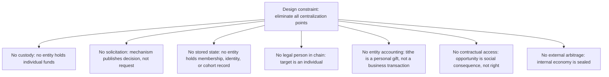

The result is a model that is **regulatorily inert**: no entity to license, compel, freeze, or wind up. The transaction is functionally identical to a group of friends sending crypto to a friend. The enforcement is the incentive structure itself.

---

## 2. Architecture

Four layers. Each has a distinct persistence profile and threat model.

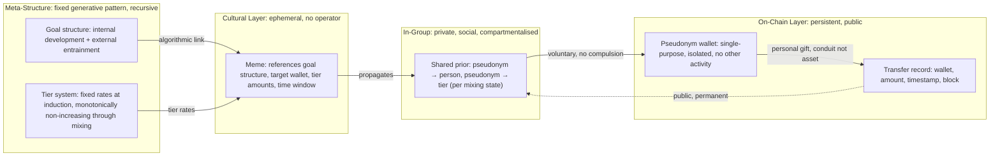

| Layer          | Persistence                | Operator | Legal person | Compromise blast radius    |
| -------------- | -------------------------- | -------- | ------------ | -------------------------- |
| Meta-Structure | Fixed (generative pattern) | None     | None         | Zero                       |
| Cultural       | Ephemeral (meme dies)      | None     | None         | Zero                       |
| On-Chain       | Permanent                  | None     | None         | Zero                       |
| Social         | Persistent (social trust)  | None     | None         | One mixing state's mapping |

No layer contains a legal person. No layer has an operator. No layer holds stored state.

---

## 3. The Meta-Structure

The meta-structure is a **fixed generative pattern**, not a maintained goal list. It is recursive: each layer is mutually reinforcing. The rules are fixed; their recursive application to changing conditions _is_ the process of development. The structure doesn't need to change because the structure _is_ the change.

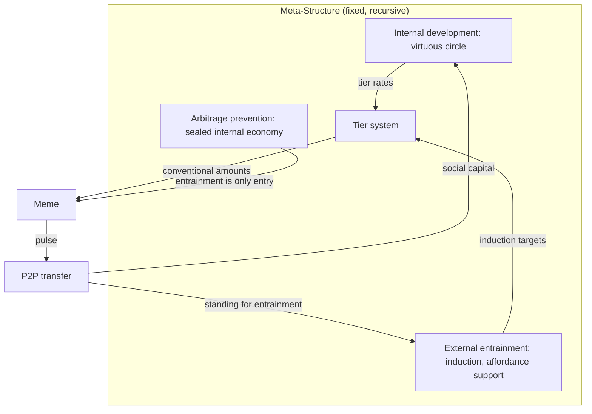

**Properties:**

- **Fixed, not evolving.** No one defines or updates the goals. The structure is the rule.
- **Recursive.** Each layer reinforces the others. The output of one layer is the input of the next.
- **Endogenous expansion.** The virtuous circle produces capacity; entrainment converts capacity to members; the border grows as the circle turns.
- **Arbitrage-sealed.** The only entry point is entrainment: bounded, one-shot, pre-cohort, rate 0. An external actor cannot inject capital to gain internal influence.
- **Policy influence is emergent, not designed.** A sufficiently large internal economy with sufficient investment in external affordances is a policy-relevant actor by scale, not by intent.

---

## 4. Tier System

The tithe is a **personal gift**. The amount is a **fixed rate determined at induction**, tiered.

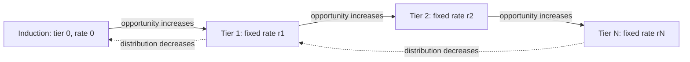

| Property                    | Mechanism                                                                                                    |
| --------------------------- | ------------------------------------------------------------------------------------------------------------ |
| Rate determination          | Fixed at induction. Each tier has a fixed conventional amount.                                               |
| Progression                 | Opportunity increases → tier increases → rate increases.                                                     |
| Regression                  | Distribution decreases → opportunity decreases → tier decreases.                                             |
| Monotonicity through mixing | Can **drop** through mixing. Cannot **jump up**. Tier is a property of the individual, not the mixing state. |
| Chain-derivable?            | No. Tier is in-group social state. Bounded concession: slow-moving, low-sensitivity.                         |

**The expected total per pulse is in-group-derivable:**

```
Expected(N) = Σ(tier_amount_i) for i ∈ mixing_state(N)
```

The in-group knows each member's tier. An out-group observer sees the amounts but not the tier structure.

**The virtuous circle, made concrete:**

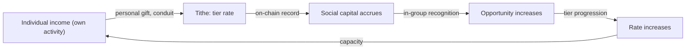

Every node reinforces the next. No external enforcement. A member who stops giving doesn't get "punished" — they stop accruing social capital, and the opportunity gradient flattens. The mixing arithmetic does the rest.

---

## 5. Pulse Lifecycle

A "pulse" is one discrete SCC event.

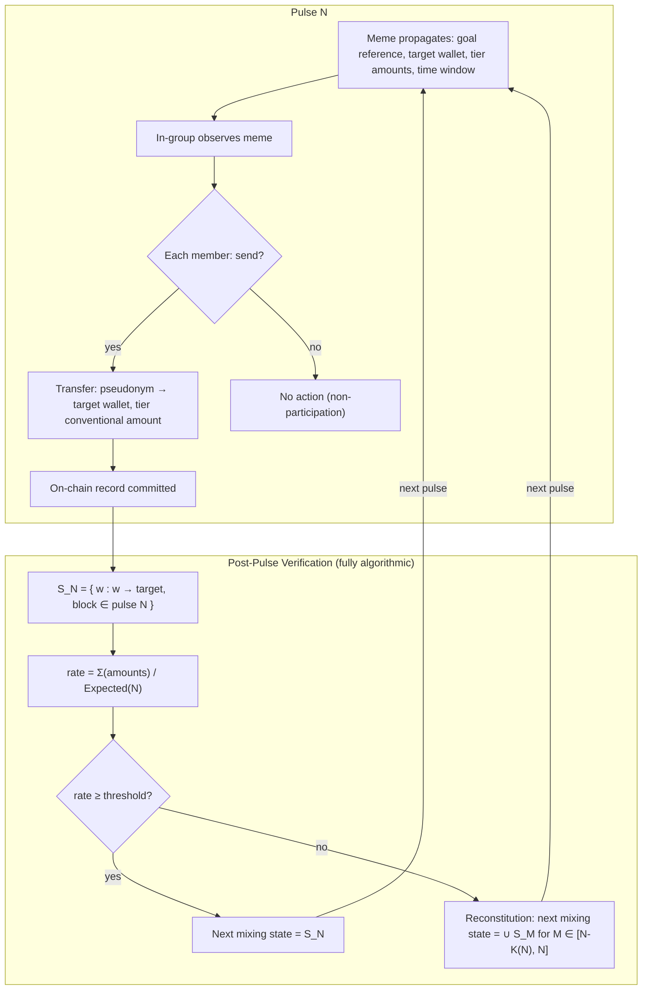

- **No compulsion.** Each decision is independent. The meme is a statement, not a solicitation.
- **Limited time window.** The meme's half-life bounds the event.
- **The cycle is explicit.** Pulse N+1 begins from the mixing state produced by pulse N.
- **The target is an individual.** No charity, no trust, no trustees. The money is theirs.

---

## 6. Mixing: Cohort Arithmetic as Security

The cohort is **not a stable unit**. It is a **transient state in a mixing process**. The security is in the **mixing pattern**, not in any single state.

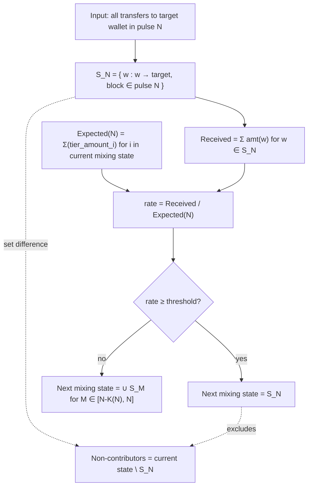

**Why mixing provides security:**

A non-contributor who fails in one mixing state is re-entered into the next pulse's composition and their absence is **indistinguishable from normal churn** across the mixing. There is no stable cohort to attack. The "nil attack surface" comes from the fact that the cohort is a **flow state**, not a container.

| Property            | Guarantee                                                                                                   |
| ------------------- | ----------------------------------------------------------------------------------------------------------- |
| No stored state     | Mixing state is a view, not a registry                                                                      |
| Deterministic       | Same chain state → same mixing state                                                                        |
| Publicly computable | Any observer can compute it (but cannot map wallets to persons or tiers)                                    |
| Anti-evasion        | A non-contributor who rotates through the mixing is diluted: absence is indistinguishable from churn        |
| Tier monotonicity   | Can drop through mixing, cannot jump up. Tier is linkable across states but slow-moving and low-sensitivity |

---

## 7. Reconstitution: A Derived Parameter

Reconstitution is **fully algorithmic in execution**. K is not negotiated; it is **derived from operational constraints**.

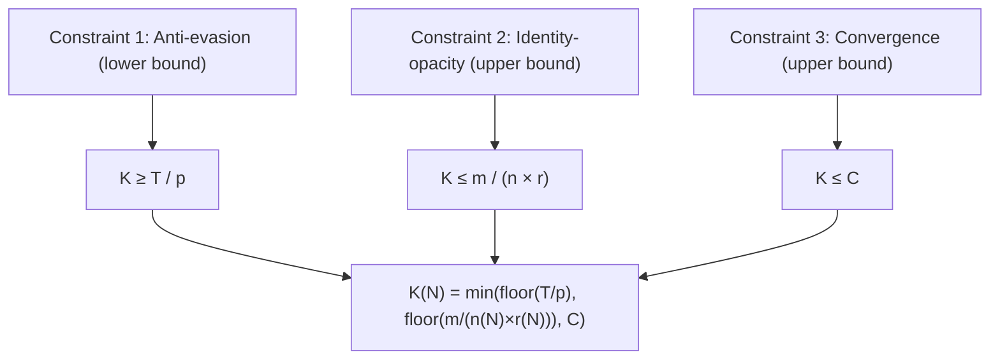

Where: _T_ = minimum evasion horizon, _p_ = pulse interval, _m_ = max wallets in-group can identify, _n_ = current mixing state size, _r_ = foreign-wallet inflow rate, _C_ = max re-stabilization time.

**If the constraints yield a unique integer, K is not a parameter — it's a consequence.**

Reconstitution is the **only operation that crosses a mixing-state boundary**:

| Operation          | Information source      | Crosses boundary?      |
| ------------------ | ----------------------- | ---------------------- |
| Normal pulse       | S_N                     | No                     |
| Shrinking          | S_N ∩ current state     | No                     |
| Non-contributor ID | current state \ S_N     | No                     |
| **Reconstitution** | **∪ S_M, M ∈ [N-K, N]** | **Yes — bounded by K** |

The breach is bounded by a fixed, computed, auditable constant. No discretionary decision.

---

## 8. Social Capital Model

**Social capital requires accumulation. Accumulation requires a persistent identity. The isolated pseudonym provides both without exposing the person.**

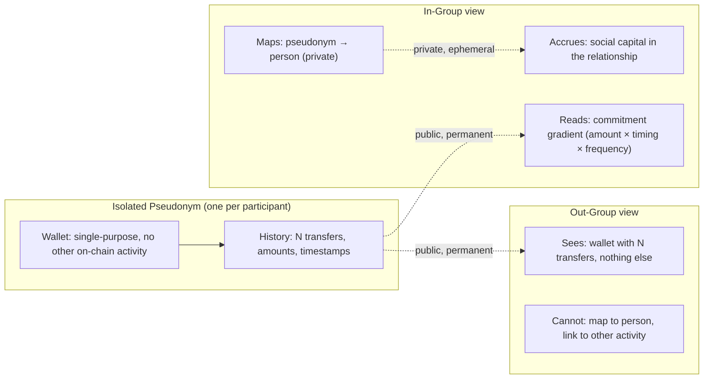

| Property            | Mechanism                                                   |
| ------------------- | ----------------------------------------------------------- |
| Accumulation        | Each pulse adds to the pseudonym's transfer history         |
| Verifiability       | On-chain, public, permanent                                 |
| Attribution         | Social: in-group knows "that pseudonym is Alice"            |
| Anonymity           | Out-group sees a wallet with N transfers and nothing else   |
| Commitment gradient | Amount × timing × frequency, continuous opt-in dial         |
| Identity protection | Wallet is isolated: no exchange, no DeFi, no other activity |

The signal is "I gave to this specific person." The commitment is personal, direct, and meaningful. The social capital accrues in the **relationship**, not in the **institution**.

---

## 9. Recipient Selection

The recipient is **not chosen by a person**. The recipient is a **function of the goal structure**, linked algorithmically.

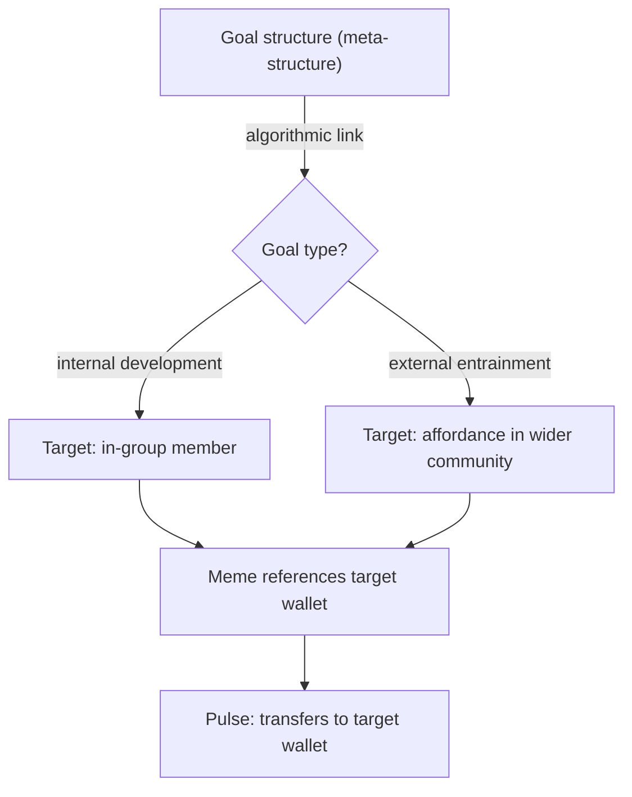

- **Internal development:** the target is an in-group member. The transfer reinforces the virtuous circle.
- **External entrainment:** the target is an affordance (a person, project, or condition) that supports the in-group's actives. The transfer is an investment in the environment.

The recipient is a **beneficiary, not a trustee**. The money is theirs. There is no fiduciary duty, no oversight, no "misuse" concern. The accountability is in the **selection**, not in post-hoc enforcement. The selection _is_ the act of trust.

---

## 10. Entrainment

Entrainment is the **induction mechanism** and the **only entry point** into the internal economy.

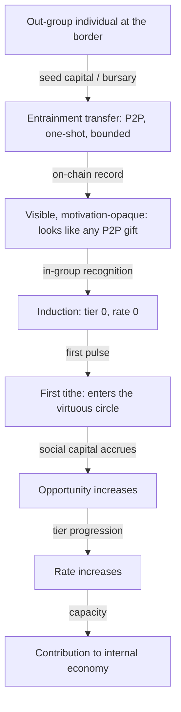

| Property                   | Mechanism                                                                           |
| -------------------------- | ----------------------------------------------------------------------------------- |
| Pre-cohort                 | Occurs before the new member's first pulse. Doesn't factor into participation rate. |
| One-shot and bounded       | Single transfer to an individual wallet.                                            |
| Motivation-opaque on-chain | Out-group observer sees a P2P gift. In-group knows it's an induction.               |
| Rate 0 at induction        | Cannot enter at a high tier. Cannot arbitrage.                                      |
| Only entry point           | The internal economy is sealed. No other path in.                                   |

**The question of when an out-group affordance becomes an in-group resource is the question of entrainment.** If participation requires seed capital or an education bursary, there is an anticipated outflow before the expectation of involvement in distribution. That is entrainment.

---

## 11. Adversarial Model

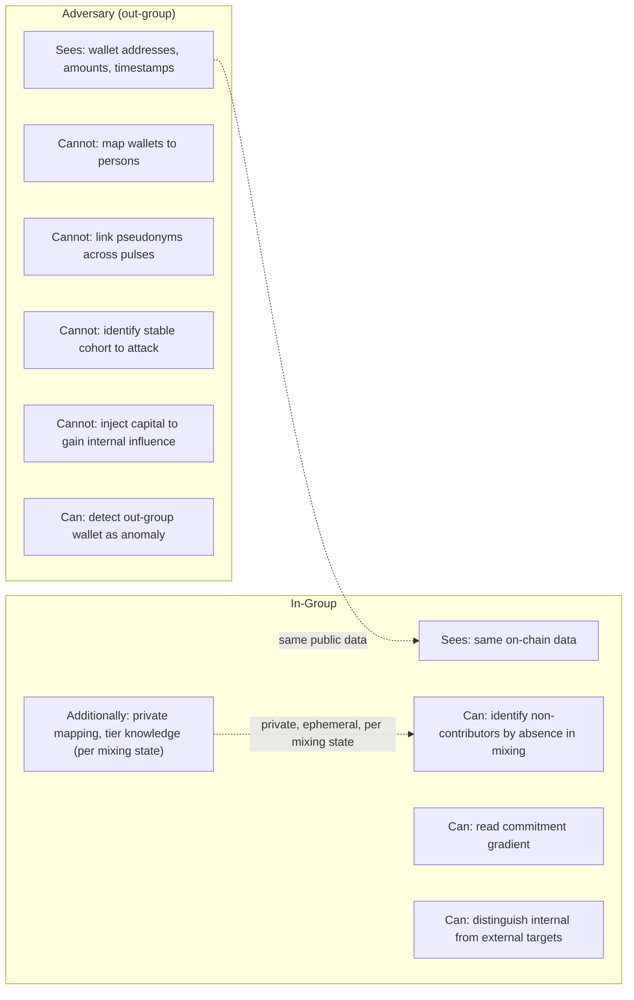

| Threat vector                | Platform model            | SCC model                                                   |
| ---------------------------- | ------------------------- | ----------------------------------------------------------- |
| Operator compulsion          | Team is a target          | No operator                                                 |
| Front-end seizure            | Domain seized, API killed | Meme isn't a domain                                         |
| Signal pollution             | Inject fake transactions  | Out-group wallet **immediately visible** to in-group        |
| Adversarial fork             | Competing protocol        | Competing meme is **noise**                                 |
| In-group mapping from chain  | Trivial                   | Impossible (isolated pseudonyms)                            |
| Targeting high-value members | Easy                      | Hard (no cross-activity, no financial profile)              |
| Persistence of attack        | Platform persists         | Meme dies, attack dies                                      |
| Regulatory freeze of target  | Possible                  | **Not possible** (individual's wallet)                      |
| Winding-up / trustee removal | Possible                  | **Not possible** (no trustees)                              |
| Cohort targeting             | Stable list is a target   | **No stable cohort** — mixing is a flow state               |
| External arbitrage           | Open to market forces     | **Sealed**: entrainment is only entry, bounded, rate 0      |
| Tier manipulation            | N/A                       | Monotonically non-increasing through mixing; cannot jump up |

**The critical inversion:** In the platform model, signal pollution is _hard to detect_. In the SCC model, it is _trivially detectable_ because the in-group has a social prior. The attacker must be **socially embedded** to succeed — a much higher bar than technical access.

**The one residual vulnerability:** The in-group's private mapping (pseudonym → person, pseudonym → tier) is the only persistent, linkable element. It is small, compartmentalised per mixing state, and ephemeral. Blast radius of compromise: _n_ identities in one mixing state, not the entire in-group.

---

## 12. Regulatory Surface

| Domain                         | Hook                                  | Status                                                                                                                                                         |
| ------------------------------ | ------------------------------------- | -------------------------------------------------------------------------------------------------------------------------------------------------------------- |
| Custody / money transmission   | Entity holds user funds               | **Absent.** Self-custody, direct P2P                                                                                                                           |
| Securities (Howey)             | Profit expectation, common enterprise | **Absent.** Personal gift, no profit expectation                                                                                                               |
| Fundraising / solicitation     | Active request for funds              | **Absent.** Meme is a statement, not a request                                                                                                                 |
| AML / CTF                      | Coordinated transfer pattern          | **Absent on senders.** No intermediary. Recipient is an individual receiving a gift                                                                            |
| Partnership / joint venture    | Group acting in concert               | **Absent.** No shared profit. Independent absolute gifts                                                                                                       |
| Charity regulation             | Trustees, fiduciary                   | **Absent.** No charity, no trustees                                                                                                                            |
| Regulatory freeze / winding-up | State action against legal person     | **Not possible.** No legal person in chain                                                                                                                     |
| Business / entity regulation   | Commercial entity, accounting         | **Absent.** No entity. Each individual's income is their own                                                                                                   |
| CGT — donor                    | Disposal at market value              | **Structurally zero.** Crypto purchased and transferred in a single atomic act. No holding period, no appreciation, no gain. Crypto is a conduit, not an asset |
| CGT — recipient                | Nil cost basis                        | **Present but deferred.** CGT on future disposal. No event at receipt                                                                                          |

**The model is regulatorily inert.** The only surface is the recipient's deferred CGT on future disposal, which is a personal tax matter identical to receiving any crypto gift.

---

## 13. Key Management

The asymmetry: **the sender's pseudonym is disposable; the recipient's wallet accumulates.**

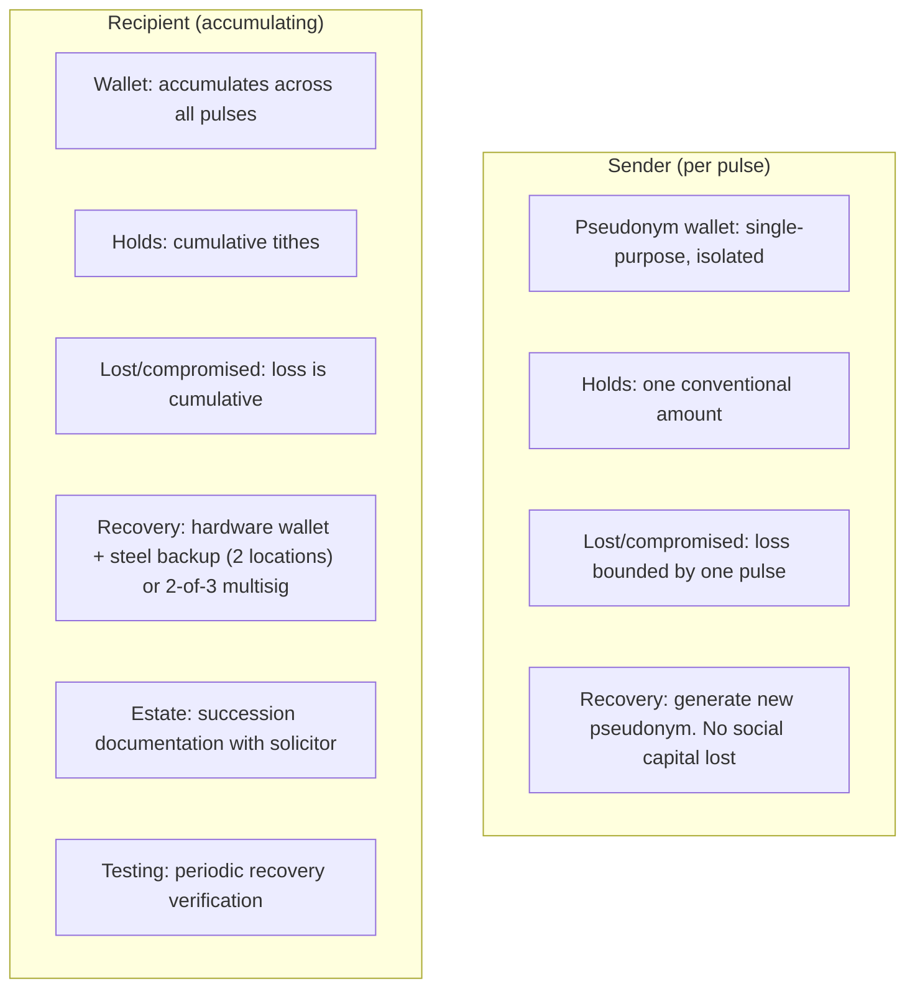

| Party     | Risk                                            | Mitigation                                                                                                                                                                                     |
| --------- | ----------------------------------------------- | ---------------------------------------------------------------------------------------------------------------------------------------------------------------------------------------------- |
| Sender    | Loss bounded by one pulse's conventional amount | Basic hardware wallet. New pseudonym on loss. No social capital lost (in-group maps to person, not wallet)                                                                                     |
| Recipient | Loss is cumulative across all pulses            | Hardware wallet + steel backup in two geographically separate locations. Or 2-of-3 multisig (one key with trusted in-group member). Estate/succession documentation. Periodic recovery testing |

The "zero attack surface" principle extends to key management: the sender's wallet is a **throwaway**; the recipient's wallet is **protected by redundancy**. Neither is a single point of failure in the way a platform's hot wallet is.

---

## 14. Scale

The in-group is **not a fixed boundary**. It is a growing boundary whose rate of growth is a function of the virtuous circle's output.

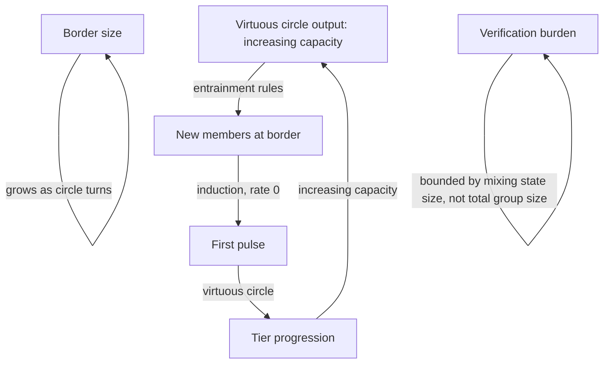

- The in-group grows because the virtuous circle produces increasing capacity, and entrainment converts that capacity to new members.
- The verification burden is bounded by **mixing state size**, not total in-group size. A member in mixing state A doesn't need to know the mapping for mixing state B.
- Scale is limited by the rate of internal economic development, not by a structural ceiling.
- The model scales **through** entrainment, which is endogenous to the meta-structure.

---

## 15. Design Invariants

| #   | Invariant                                                    | Enforcement                                                                            |
| --- | ------------------------------------------------------------ | -------------------------------------------------------------------------------------- |
| 1   | No entity holds individual funds                             | Self-custody; direct P2P                                                               |
| 2   | No entity holds a membership list                            | Mixing state is a computed function of the public ledger                               |
| 3   | No entity solicits                                           | Meme is a statement of decision, not a request                                         |
| 4   | No external or legal compulsion                              | Each transfer is voluntary, unilateral, irrevocable                                    |
| 5   | No stored state                                              | All information is on-chain, computed, or ephemeral social                             |
| 6   | No cross-activity linking                                    | Pseudonym wallet is single-purpose, isolated                                           |
| 7   | Limited risk per pulse                                       | Bounded by Σ(tier amounts) × participation rate × time window                          |
| 8   | Out-group transfers are visible                              | In-group social prior makes anomalies detectable                                       |
| 9   | Meme ephemerality is a feature                               | Short-lived signal makes out-group interference visible                                |
| 10  | Reconstitution is fully algorithmic                          | Threshold and K are derived parameters                                                 |
| 11  | No legal person in the chain                                 | Target is an individual, not an organization                                           |
| 12  | Tithe is a personal gift, not a business transaction         | No entity, no accounting, no contractual consideration                                 |
| 13  | Opportunity is a social consequence, not a contractual right | No membership, no fee, no access agreement                                             |
| 14  | Tier is monotonically non-increasing through mixing          | Can drop, cannot jump up. Property of individual, not mixing state                     |
| 15  | Mixing state is transient, not a stable unit                 | No stable cohort to attack. Security is in the flow, not the container                 |
| 16  | Meta-structure is a fixed generative pattern                 | No operator, no updater. The structure is the rule                                     |
| 17  | Entrainment is the only entry point                          | Pre-cohort, one-shot, bounded, rate 0, motivation-opaque                               |
| 18  | Internal economy is sealed against external arbitrage        | Entrainment is the only entry. Cannot inject capital to gain influence                 |
| 19  | Expansion is endogenous                                      | Virtuous circle produces capacity; entrainment converts to members; border grows       |
| 20  | Policy influence is emergent, not designed                   | Consequence of scale: internal economy + affordance investment = policy-relevant actor |
| 21  | Crypto is a conduit, not an asset                            | Purchased and transferred in a single atomic act. CGT is structurally zero             |
| 22  | Recipient is a beneficiary, not a trustee                    | No fiduciary duty. Accountability is in selection, not oversight                       |

---

## 16. The Virtuous Circle as Enforcement

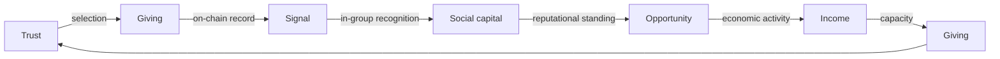

The system's coherence is **self-reinforcing**. The members who participate most deeply in distribution accrue the most social capital, which generates the most opportunity, which generates the most income, which generates the most capacity to give.

The system doesn't need external enforcement because **the incentive structure is the enforcement**. A member who stops giving doesn't get "punished" — they simply stop accruing social capital, and the opportunity gradient flattens. The mixing arithmetic does the rest.

The selection of the recipient is the act of trust. The money is theirs. There is no "misuse" scenario. The accountability is **upfront, not retrospective** — it's in the choosing, not in the monitoring.

The system's integrity is **emergent from the pattern**, not imposed by a rule.

---

## 17. Limitations

**The target's key management is the primary operational risk.** The recipient's wallet accumulates. If keys are lost or compromised, the funds are gone. Mitigation: hardware wallet, steel backups, multisig, estate planning. Residual risk: irrecoverable loss.

**The meme is the weakest link in persistence.** The on-chain record is permanent. The meme is not. If the cultural pattern dies, the coordination layer dies with it. Each meme is a one-shot. The model is a **pulse**, not a **platform**.

**The expected total is in-group-derivable, not purely chain-derivable.** Tier assignment is social state. Bounded concession: slow-moving, low-sensitivity, and the mixing protects the high-sensitivity state (membership), not tier.

**The meta-structure's fixity is what makes the system self-sustaining.** The rules are fixed; the recursive application of those rules to changing conditions is the mechanism of internal development and external expansion. The system does not adapt to external change — it extends into external change through entrainment. The border grows as the circle turns.

---

## 18. References and Analogues

| Source                                                                           | Relevance                                                                                   |
| -------------------------------------------------------------------------------- | ------------------------------------------------------------------------------------------- |
| _The Stateless Pattern_ (arXiv:2601.17875, 2026)                                 | Coordination without persistent server state. SCC applies the same principle to P2P tithing |
| Hariharan, S. _Pseudonymous Reputation_ (2021)                                   | On-chain history as the basis for pseudonymous social capital                               |
| Charness, Friedman & Cox. _Reputation and Influence in Charitable Giving_ (2012) | The signal is in the pattern, not the identity                                              |
| Evans-Pritchard, E.E. _The Nuer_ (1940)                                          | Stateless segmentary society. The mixing model is a digital analogue                        |
| FCA P2P Enforcement (Sep 2026)                                                   | "Does not affect ordinary individuals making occasional personal crypto transactions"       |
| FATF Virtual Assets Update (2025) + DeFi Report (Jul 2026)                       | COSI test. SCC scores zero on all indicators                                                |

---

## Appendix: Formal Specification

```
SCC_PULSE(N):
  Input:  target_wallet (algorithmic function of goal structure),
          tier_amounts (fixed per member, determined at induction),
          time_window,
          mixing_state(N)

  For each member w ∈ mixing_state(N):
    if w purchases crypto and transfers tier_amount(w) to target_wallet
       within time_window (single atomic act, no holding period):
      record (w, amount, timestamp) on-chain

  S_N = { w : w → target_wallet, block ∈ pulse N }
  Expected(N) = Σ(tier_amount(w) for w ∈ mixing_state(N))
  rate = Σ(amounts in S_N) / Expected(N)
  K(N) = min( floor(T/p), floor(m / (n(N) × r(N))), C )

  if rate ≥ threshold:
    mixing_state(N+1) = S_N
  else:
    mixing_state(N+1) = ∪{S_M : M ∈ [N-K(N), N]}

  return mixing_state(N+1), rate

ENTRAINMENT:
  Input:  out-group individual, seed_amount
  Transfer: P2P, one-shot, to individual wallet
  On-chain: visible, motivation-opaque
  Post-transfer: tier 0, rate 0, enters first pulse
  Constraint: only entry point into internal economy

TIER:
  tier(w) = 0 at induction
  tier(w) increases as opportunity increases (in-group social determination)
  tier(w) decreases as distribution decreases
  tier(w) is monotonically non-increasing through mixing
  tier(w) is a property of the individual, not the mixing state

META-STRUCTURE:
  Fixed generative pattern. No operator. No updater.
  Recursive: each layer's output is the next layer's input.
  Internal economy sealed: entrainment is the only entry.
  Policy influence: emergent property of scale, not a designed objective.

INVARIANTS:
  ∀ w ∈ mixing_state(N): w is a single-purpose pseudonym (no other on-chain activity)
  ∀ w ∈ mixing_state(N): w's identity mapping is private to the in-group (per mixing state)
  ∀ pulse: no entity holds funds between sender and target
  ∀ pulse: no entity holds mixing state as stored state
  ∀ pulse: no entity solicits; the meme is a statement, not a request
  ∀ pulse: target is an individual, not a legal person
  ∀ pulse: K(N) is computed, not agreed
  ∀ pulse: reconstitution is deterministic and auditable from the chain
  ∀ pulse: the tithe is a personal gift, not a business transaction
  ∀ pulse: opportunity is a social consequence, not a contractual right
  ∀ pulse: crypto is a conduit, not an asset (purchased and transferred atomically)
  ∀ member: tier is monotonically non-increasing through mixing
  ∀ entrainment: pre-cohort, one-shot, bounded, rate 0, motivation-opaque
  ∀ meta-structure: fixed generative pattern, no operator, no updater
  ∀ internal economy: sealed against external arbitrage
  ∀ expansion: endogenous, driven by virtuous circle output
  ∀ policy influence: emergent, not designed
```
