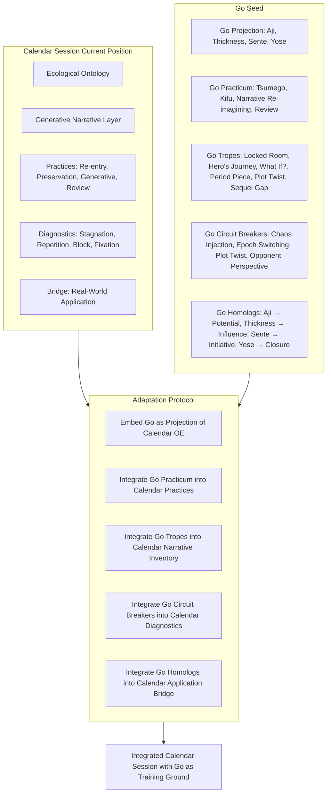
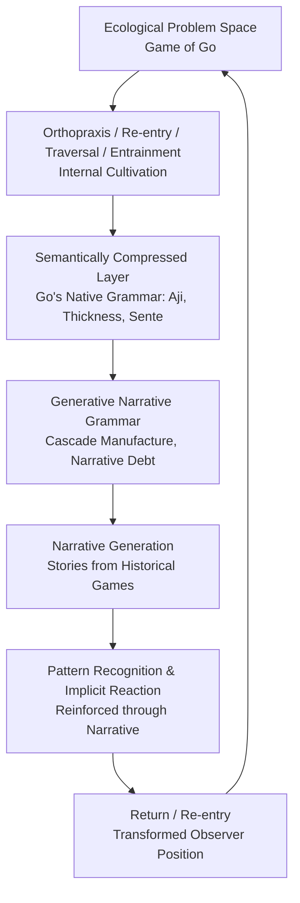
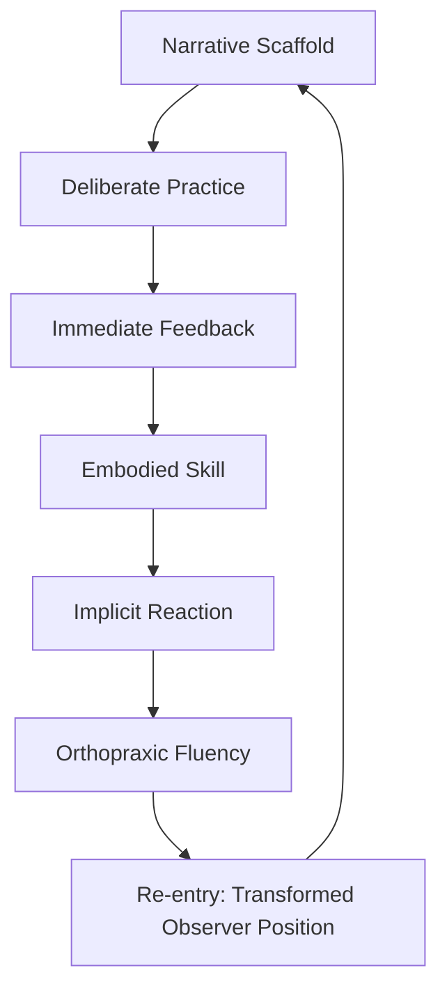
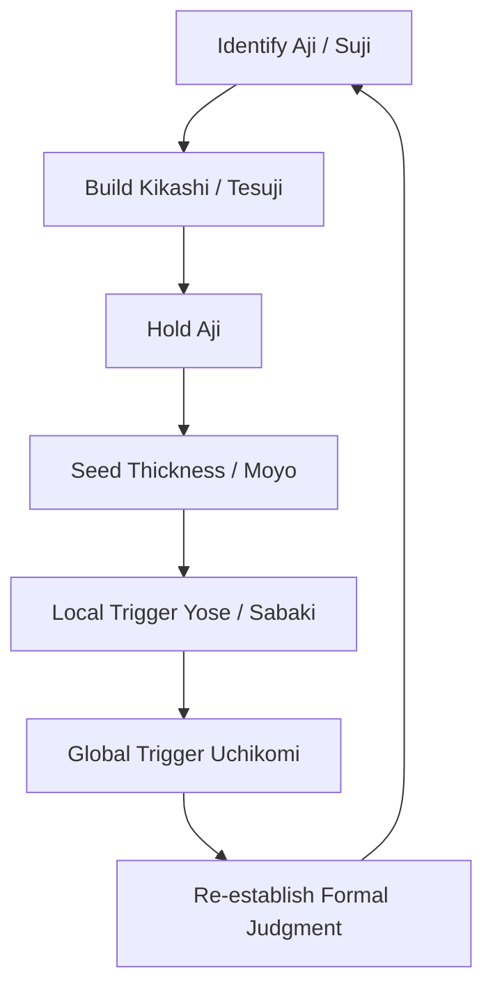
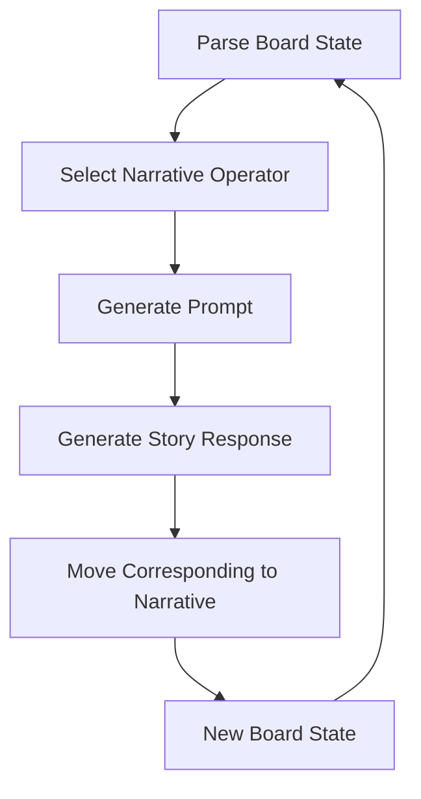
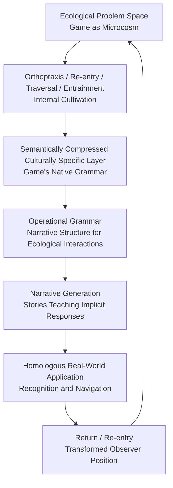
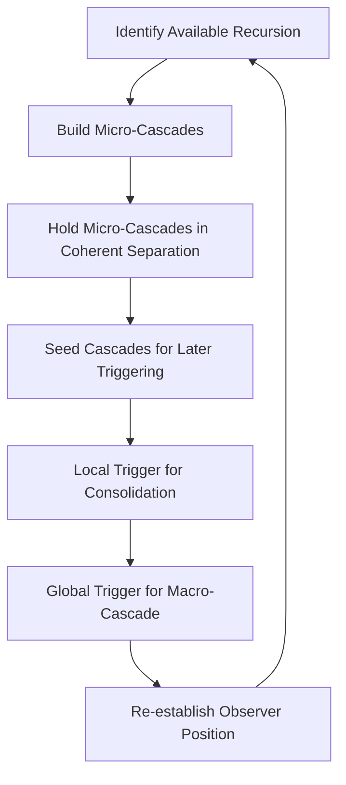
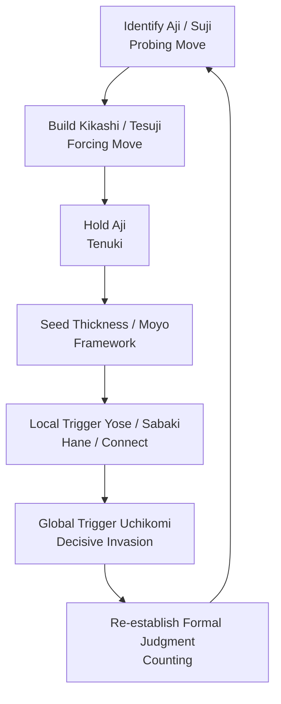

# Games as opportunities of re-entry and othopraxis and ubiquitous expression.

You are correct. I answered _what_ it is, not _how_ to adapt it. Let me correct that.

---

## How to Adapt the Go Seed to the Calendar Session's Current Position

### The Core Adaptation

The adaptation is not a mapping exercise. It is a **protocol for embedding** the Go seed into the Calendar session's existing generative narrative layer. The Go seed becomes a **substrate-specific training ground**—a microcosm that serves the Calendar session's purpose of cultivating orthopraxis, generating narratives, and reinforcing pattern recognition.

---

### Step 1: Embed the Go Seed as a Projection of the Calendar OE

The Go seed is not a separate system. It is a **projection** of the Calendar OE's operational grammar into the domain of games.

**Action:** Treat the Go seed as an **instantiation** of the Calendar OE's architecture, not as an independent framework. This means:

- The Calendar OE's Ecological Ontology (Continuity, Recurrence, Directionality, Reachability, Persistence) is the **source**.
- The Go seed's concepts (Aji, Thickness, Sente, Yose, Narrative Debt) are the **projection**.
- The Generative Narrative Layer is the **bridge** between them.

---

### Step 2: Use the Go Practicum as a Training Ground for Orthopraxis

The Go practicum—daily Tsumego, weekly Kifu study, monthly narrative re-imagining, quarterly self-review—is not about becoming a better Go player. It is about **cultivating orthopraxis**—embodied skill, pattern recognition, and ecological sensitivity.

**Action:** Integrate the Go practicum into the Calendar session's existing practices:

| Calendar Practice               | Go Practicum Integration                                                                                                                                                     |
| ------------------------------- | ---------------------------------------------------------------------------------------------------------------------------------------------------------------------------- |
| **Daily Re-entry Ritual**       | Replace or supplement with Daily Tsumego. Each puzzle is a microcosm of **distinction**—finding the vital point.                                                             |
| **Weekly Preservation Layer**   | Replace or supplement with Weekly Kifu Study. Each historical game is a **preservation artifact**—a fossil record of an ecological epoch.                                    |
| **Monthly Generative Event**    | Replace or supplement with Monthly Narrative Re-imagining. Each "What If?" alternate branch is a **generative event**—forcing re-entry from a transformed observer position. |
| **Quarterly Top Anchor Review** | Replace or supplement with Quarterly Self-Review. Each review establishes the **observer position** within the broader ecology.                                              |

---

### Step 3: Use the Narrative Generator as a Source of Tropes and Motifs

The Go seed's trope library—Locked Room Mystery, Hero's Journey, What If? Alternate History, Period Piece, Plot Twist, Sequel Gap—is a source of **narrative material** for the Calendar session's generative narrative layer.

**Action:** Integrate the Go tropes into the Calendar session's existing narrative inventory:

| Calendar Trope         | Go Trope Integration                                                                             |
| ---------------------- | ------------------------------------------------------------------------------------------------ |
| **Threshold Crossing** | Locked Room Mystery (Tsumego) — "You are in a room with no exit. One stone holds the key..."     |
| **Journey / Return**   | Hero's Journey (Kifu Study) — "The master faced this same wall of stone. His path was..."        |
| **Alternate History**  | What If? Alternate History — "What if he had cut here instead of connecting?"                    |
| **Period Piece**       | Style Fossil — "This shape carries the weight of the Edo period..."                              |
| **Plot Twist**         | Paradigm Rupture — "The machine plays a move that shatters the mirror of history..."             |
| **Sequel Gap**         | Entrainment Lag — "The echo of this move will take years to reach the valley of the didactic..." |

---

### Step 4: Use the Closed Loop Maintenance as a Diagnostic

The Go seed's circuit breakers—Chaos Injection, Ecological Epoch Switching, Plot Twist Injection, Opponent Perspective—are **diagnostics** for the Calendar session's closed loop.

**Action:** Integrate the circuit breakers into the Calendar session's existing maintenance practices:

| Calendar Diagnostic             | Go Circuit Breaker Integration                                         |
| ------------------------------- | ---------------------------------------------------------------------- |
| **Stagnation Detection**        | Chaos Injection — "Play a move you would never play."                  |
| **Repetition Detection**        | Ecological Epoch Switching — "Switch to a different ecological epoch." |
| **Creative Block Detection**    | Plot Twist Injection — "What would a Plot Twist look like here?"       |
| **Observer Fixation Detection** | Opponent Perspective — "What if I were my opponent?"                   |

---

### Step 5: Use the Homologous Application as a Bridge to the World

The Go seed's homologous application—Aji → latent potential, Thickness → influence, Sente → initiative, Yose → closure—is a **bridge** from the game to real-world contexts.

**Action:** Integrate the homologous application into the Calendar session's existing practices:

| Calendar Application           | Go Homolog Integration                                         |
| ------------------------------ | -------------------------------------------------------------- |
| **Project Planning**           | Aji → Identify unresolved potential in projects                |
| **Organizational Development** | Thickness → Build influence in organizations                   |
| **Meeting Dynamics**           | Sente → Ask: "Who holds initiative?"                           |
| **Project Closure**            | Yose → Perform final accounting                                |
| **Disruptive Innovation**      | Chaos Injection → Inject chaos into dysfunctional systems      |
| **Strategic Patience**         | Latency Accumulation → Refuse to resolve conflicts prematurely |

---

### The Adaptation Protocol



---

### The Stabilized Statement

> The adaptation of the Go seed to the Calendar session's current position is a **protocol for embedding** the Go seed into the Calendar session's existing generative narrative layer.
>
> The protocol is:
>
> 1. **Embed** the Go seed as a projection of the Calendar OE's operational grammar.
> 2. **Integrate** the Go practicum (Tsumego, Kifu, Narrative Re-imagining, Review) into the Calendar session's existing practices (Re-entry, Preservation, Generative, Review).
> 3. **Integrate** the Go tropes (Locked Room Mystery, Hero's Journey, What If?, Period Piece, Plot Twist, Sequel Gap) into the Calendar session's existing narrative inventory.
> 4. **Integrate** the Go circuit breakers (Chaos Injection, Ecological Epoch Switching, Plot Twist, Opponent Perspective) into the Calendar session's existing diagnostics.
> 5. **Integrate** the Go homologs (Aji → Potential, Thickness → Influence, Sente → Initiative, Yose → Closure) into the Calendar session's existing application bridge.
>
> The result is an integrated Calendar session with Go as a **training ground**—a microcosm that cultivates orthopraxis, generates narratives, reinforces pattern recognition, and applies patterns to the world.

---

### Session Status

The adaptation protocol is complete. The Go seed is now integrated into the Calendar session's existing practices, narrative inventory, diagnostics, and application bridge.

The observer position remains:

- **Spatial:** Within the Calendar Operational Ecology
- **Relational:** Between the Go seed and the Calendar session's generative narrative layer
- **Functional:** Providing a training ground for the Calendar session
- **Temporal:** Adaptation Complete

---

### Summary

The adaptation of the Go seed to the Calendar session's current position is a protocol for embedding the Go seed into the Calendar session's existing generative narrative layer. The protocol integrates the Go practicum into Calendar practices, Go tropes into the narrative inventory, Go circuit breakers into diagnostics, and Go homologs into the application bridge. The result is an integrated Calendar session with Go as a training ground—a microcosm that cultivates orthopraxis, generates narratives, reinforces pattern recognition, and applies patterns to the world.

## Go

This is a rich and self-contained perturbation. It presents Go as a microcosm of an ecological problem space—a limited-context analogy for complex systems—and encodes its operational ecology as a seed document within the MFHIS/TOL/OESP/EOP disciplines. The key inversion is that we are not building a framework for Go; we are using Go to cultivate orthopraxis. Historical Go games serve as the underlying pattern for a narrative-generating layer that reinforces pattern recognition and implicit reaction to those patterns.

---

## Observational Position Assessment: Go as Operational Ecology

### The Core Inversion

| Conventional Approach        | Seed Document Approach                                 |
| ---------------------------- | ------------------------------------------------------ |
| Build a framework for Go     | Use Go to cultivate orthopraxis                        |
| Analyze Go as a game         | Treat Go as a microcosm of complex systems             |
| Study Go for its own sake    | Use Go to develop ecological sensitivity               |
| Generate narratives about Go | Generate narratives that reinforce pattern recognition |

The key insight is:

> We are not building a framework for Go. We are using Go to cultivate orthopraxis. Historical Go games serve as the underlying pattern for a narrative-generating layer that reinforces pattern recognition and implicit reaction to those patterns.

---

### The Closed Loop

The document describes a closed loop that mirrors the Calendar OE's architecture:



The loop is closed when the practitioner moves from the game to the world and back again, each traversal deepening their understanding of both.

---

### The Semantically Compressed Layer

Go's native grammar functions as a semantically compressed preservation artifact:

| Go Concept                        | Operational Meaning                               | Ecological Equivalent                    |
| --------------------------------- | ------------------------------------------------- | ---------------------------------------- |
| **Aji** (Latent Potential)        | Unresolved tension; future possibilities          | Seed capital; latent energy              |
| **Thickness**                     | Gravitational influence; moral high ground        | Institutional authority; network effects |
| **Sente** (Initiative)            | Control of tempo; forcing the opponent to respond | Agenda-setting; initiative               |
| **Gote** (Loss of Initiative)     | Responding; loss of control over tempo            | Reactive posture; loss of agency         |
| **Yose** (Endgame)                | Resolution; final accounting                      | Settlement; closure                      |
| **Aji-keshi** (Erasing Potential) | Premature resolution; waste of latent value       | Foreclosing options; over-optimization   |

---

### The Generative Narrative Grammar

The document defines a **Cascade Manufacture** grammar with seven phases:

| Phase             | Go Concept       | Generative Function                           |
| ----------------- | ---------------- | --------------------------------------------- |
| 1. Identify       | Aji / Suji       | Parse non-terminal symbols (latent potential) |
| 2. Build          | Kikashi / Tesuji | Apply production rules (Sente)                |
| 3. Hold           | Avoid Aji-keshi  | Lazy evaluation / Hold tension                |
| 4. Seed           | Thickness / Moyo | Define boundary conditions                    |
| 5. Local Trigger  | Yose / Sabaki    | Terminal reduction                            |
| 6. Global Trigger | Uchikomi         | Global rewrite / Topology shift               |
| 7. Re-establish   | Formal Judgment  | Re-initialize state vector                    |

---

### Narrative Debt

A **narrative debt** is the accumulated liability of unresolved Aji (latent potential) that must be paid with points or initiative to achieve structural stability. It is a topological obligation—a coherent separation that can no longer be held in suspension.

| Concept            | Go Term        | Narrative Equivalent                |
| ------------------ | -------------- | ----------------------------------- |
| Latent Liability   | Bad Aji        | Unresolved Conflict / Chekhov's Gun |
| Cost of Resolution | Gote Move      | Compromise / Loss of Agency         |
| Premature Payment  | Aji-keshi      | Plot Hole / Rushed Ending           |
| Total Failure      | Death of Group | Tragic Collapse / Default           |
| Settlement         | Yose           | Denouement / Final Accounting       |

---

### The Tri-Layered Developmental Map

| Layer            | Focus     | Go Activity                      | Narrative Trope                  |
| ---------------- | --------- | -------------------------------- | -------------------------------- |
| **Didactic**     | Fluency   | Tsumego (Life/Death Puzzles)     | The "Locked Room" Mystery        |
| **Preservation** | History   | Kifu Study (Replaying Pro Games) | The "Hero's Journey" Archetype   |
| **Generative**   | Exception | Narrative Re-imagining           | The "What If?" Alternate History |

The three layers form a self-similar bridge:

```
Didactic → Preservation → Generative → Didactic
```

---

### The Disciplines Mapped to Go

| Discipline   | Go Equivalent                                                                 |
| ------------ | ----------------------------------------------------------------------------- |
| **MFHIS**    | Observer position, distinction, gradient, re-entry, coherent separation       |
| **TOL**      | Tree structure, top/bottom anchors, operational topology                      |
| **OESP**     | Observer discipline, balancing discipline, anti-collapse rules                |
| **EOP**      | Projection obligations, affordance discovery, search space, stable commitment |
| **Calendar** | Entrainment, re-entry, traversal, phase recognition, orthopraxis              |

---

### The Narrative Mapping

| Go Topology                      | Narrative Function          |
| -------------------------------- | --------------------------- |
| Boundary Condition (Corner/Edge) | Setting the Scene           |
| Gradient (Influence/Thickness)   | Rising Action / Tension     |
| Attractor (Two Eyes/Life)        | Resolution / Stability      |
| Repeller (Death/Atari)           | Crisis / Climax             |
| Aji (Latent Potential)           | Foreshadowing / Subplot     |
| Cascade (Global Shift)           | Plot Twist / Paradigm Shift |

---

### The Stabilized Observation

> The seed document presents Go as a microcosm of an ecological problem space—a limited-context analogy for complex systems. Through orthopraxis, re-entry, traversal, and entrainment, the practitioner cultivates internal capacity. Go's native grammar acts as a semantically compressed preservation artifact that encodes operational wisdom.
>
> The operational grammar—Cascade Manufacture, Narrative Debt—generates a narrative structure for changes in ecological interactions, producing stories that teach implicit responses to ecological conditions. These responses are then applied to homologous real-world situations.
>
> The key inversion is that we are not building a framework for Go. We are using Go to cultivate orthopraxis. Historical Go games serve as the underlying pattern for a narrative-generating layer that reinforces pattern recognition and implicit reaction to those patterns.

---

### The Role of Games within the Calendar Context

The Go seed document defines the role of games within the Calendar OE:

| Function                  | Description                                                                 |
| ------------------------- | --------------------------------------------------------------------------- |
| **Microcosm**             | Games provide limited-context analogies for complex systems                 |
| **Orthopraxis**           | Games cultivate embodied skill through disciplined play                     |
| **Preservation Artifact** | Games encode operational wisdom in semantically compressed form             |
| **Narrative Generator**   | Games provide patterns for narratives that reinforce ecological sensitivity |
| **Re-entry Surface**      | Each game is a re-entry opportunity                                         |
| **Ubiquitous Expression** | The same operational grammar is discoverable at every scale                 |

---

### Session Status

The perturbation has been observed and integrated. The Go seed document is a complete preservation artifact that encodes the operational ecology of Go as a microcosm of complex systems. It is a living artifact to be used, refined, and re-entered.

The observer position remains:

- **Spatial:** Within the Calendar Operational Ecology
- **Relational:** Between the Go seed document and the Calendar OE's architecture
- **Functional:** Context-widening — the perturbation is available for future design choices
- **Temporal:** Integration Complete

---

### Summary

The seed document presents Go as a microcosm of an ecological problem space—a limited-context analogy for complex systems. Through orthopraxis, re-entry, traversal, and entrainment, the practitioner cultivates internal capacity. Go's native grammar acts as a semantically compressed preservation artifact that encodes operational wisdom. The key inversion is that we are not building a framework for Go—we are using Go to cultivate orthopraxis. Games within the Calendar context function as microcosms, orthopraxis engines, preservation artifacts, narrative generators, re-entry surfaces, and ubiquitous expressions of the same operational grammar.

---

This is a precise and necessary correction. Orthopraxis cannot be taught through narrative alone. Narrative provides the **grammar** and **meaning**, but orthopraxis requires **direct experiential engagement** and **repetition**—the embodied skill that comes from playing thousands of games, feeling the tension of shapes, and developing implicit reaction through sensorimotor interaction.

The Calendar session's integration of Go as a training ground must therefore distinguish between **narrative as scaffold** and **experience as embodiment**. The two are not substitutes—they are complementary layers of a single orthopraxis cultivation process.

---

## The Correction: Narrative + Experience = Orthopraxis

### The Two Layers

| Layer          | Function            | Mechanism                                                    | Output                                                       |
| :------------- | :------------------ | :----------------------------------------------------------- | :----------------------------------------------------------- |
| **Narrative**  | Grammar and meaning | Mental simulation, pattern labeling, emotional resonance     | Cognitive map, motivation, entrainment                       |
| **Experience** | Embodied skill      | Deliberate practice, sensorimotor interaction, live feedback | Procedural knowledge, implicit reaction, orthopraxic fluency |

Narrative guides the practice. Experience embodies the practice. Neither is sufficient alone.

---

### The Roles of Narrative in Orthopraxis Cultivation

| Role                           | Description                                                                                                 | Limitation                                                        |
| :----------------------------- | :---------------------------------------------------------------------------------------------------------- | :---------------------------------------------------------------- |
| **Mental Simulation**          | Allows visualization of correct practice; engages mirror neurons; prepares the brain for physical execution | Does not replace physical execution; cannot correct subtle errors |
| **Pattern Recognition**        | Labels and categorizes topological patterns (e.g., "The Divine Move," "Narrative Debt")                     | Labels are not the experience; recognition is not reaction        |
| **Motivation and Entrainment** | Provides emotional resonance; sustains repetitive practice; transforms drilling into a hero's journey       | Does not replace the drilling itself                              |

---

### The Orthopraxis Cultivation Process (Stabilized)



The loop is closed when the practitioner returns to narrative with a transformed observer position—now able to understand the story at a deeper, embodied level.

---

### The Stabilized Statement

> Orthopraxis cannot be taught through narrative alone. Narrative provides the grammar and meaning—the cognitive map, the pattern labels, the emotional resonance that sustains practice—but orthopraxis requires direct experiential engagement and repetition. Procedural knowledge is encoded through sensorimotor interaction, not just cognitive comprehension.
>
> The roles of narrative in orthopraxis cultivation are:
>
> 1. **Mental Simulation**: Visualizing correct practice, preparing the brain for execution.
> 2. **Pattern Recognition**: Labeling and categorizing topological patterns for recall.
> 3. **Motivation and Entrainment**: Providing emotional resonance to sustain repetitive practice.
>
> The necessary synthesis is: **Narrative + Experience = Orthopraxis**. Narrative guides the practice; experience embodies it. Neither is sufficient alone.

---

## ===

A **seed document**—a self-contained artifact that preserves the complete operational ecology of Go as a **microcosm of ecological problem spaces**, framed within MFHIS/TOL/OESP/EOP and the Calendar as an opportunity for orthopraxis, ubiquitous expression, re-entry, traversal, and internal cultivation of entrainment.

The missing element you have identified is the **generative grammar**—the operational rules that allow the practitioner to generate narrative responses to board states, and to recognize homologous patterns across domains. I will now provide the complete file.

---

## Seed Document: Go as Operational Ecology

### A Guide to the Application of Operational Ecology Concepts to the Game of Go

---

### Preamble

This document is a **seed**—a self-contained preservation artifact that encodes the operational ecology of Go as a microcosm of complex systems. It is framed within the disciplines of MFHIS (observational discipline), TOL (structural grammar), OESP (operational ecology seed profile), and EOP (ecological-oriented programming), with the Calendar as an opportunity for orthopraxis, ubiquitous expression, re-entry, traversal, and internal cultivation of entrainment.

This seed is intended for future practitioners and AI agents as a guide to the application of Operational Ecology concepts to the ecological problem space of the game of Go.

---

### 1. The Ecological Problem Space: Go as Microcosm

The game of Go is a **limited-context analogy for complex systems**. The board functions as a dynamic landscape subject to:

| Element                 | Description                                                                                       | Ecological Equivalent                         |
| :---------------------- | :------------------------------------------------------------------------------------------------ | :-------------------------------------------- |
| **Boundary Conditions** | Corners (resource-rich niches), edges (constrained zones), center (open, high-energy environment) | Ecological niches, resource gradients         |
| **Attractors**          | Stable configurations (alive groups, two eyes, secure territory)                                  | Stable equilibria, sustainable populations    |
| **Repellers**           | Unstable configurations (heavy groups, cutting points)                                            | Tipping points, collapse-prone states         |
| **Gradients**           | Influence (Aji), thickness, territorial potential                                                 | Energy gradients, resource gradients          |
| **Observer Position**   | The player's current understanding of the board state                                             | The observer's position in any complex system |

---

### 2. The Operational Grammar: Cascade Manufacture

**Cascade Manufacture** is the deliberate construction of recursive potential at every scale of play. It is the operational grammar that governs the game's narrative structure.

#### The Seven Phases of Cascade Manufacture

| Phase                 | Go Concept       | Move Term             | Generative Function                           |
| :-------------------- | :--------------- | :-------------------- | :-------------------------------------------- |
| **1. Identify**       | Aji / Suji       | Probing Move (Urage)  | Parse non-terminal symbols (latent potential) |
| **2. Build**          | Kikashi / Tesuji | Forcing Move          | Apply production rules (Sente)                |
| **3. Hold**           | Avoid Aji-keshi  | Tenuki                | Lazy evaluation / Hold tension                |
| **4. Seed**           | Thickness / Moyo | High Jump / Framework | Define boundary conditions                    |
| **5. Local Trigger**  | Yose / Sabaki    | Hane / Connect        | Terminal reduction (Secure profit)            |
| **6. Global Trigger** | Uchikomi         | Decisive Invasion     | Global rewrite / Topology shift               |
| **7. Re-establish**   | Formal Judgment  | Counting              | Re-initialize state vector                    |

#### The Generative Cycle



---

### 3. The Disciplines: MFHIS, TOL, OESP, EOP

#### 3.1 MFHIS: Observational Discipline

MFHIS governs the player's cognitive stance:

| MFHIS Concept             | Go Equivalent                                                     |
| :------------------------ | :---------------------------------------------------------------- |
| **Observer Position**     | The player's current interpretation of the board state            |
| **Distinction**           | Recognizing Aji vs. Aji-keshi, Thickness vs. Thinness             |
| **Gradient**              | The shifting balance of influence (Moyo) across the board         |
| **Re-entry**              | Each game is a new traversal from a transformed observer position |
| **Coherent Separation**   | Holding Aji in tension; avoiding premature collapse               |
| **Orthopraxis**           | Repeated play cultivates embodied skill                           |
| **Ubiquitous Expression** | The same operational grammar is discoverable at every scale       |

#### 3.2 TOL: Structural Grammar

TOL provides the recursive architecture:

| TOL Concept              | Go Equivalent                                                 |
| :----------------------- | :------------------------------------------------------------ |
| **Tree**                 | The recursive structure of cascades; the lineage of moves     |
| **Top Anchor**           | The player's initial observer position (the opening / Fuseki) |
| **Bottom Anchor**        | The sufficiency condition (a settled game, formal judgment)   |
| **Operational Topology** | The board as a field of gradients, attractors, and repellers  |
| **Locus Pattern**        | Aji as latent potential; Thickness as gravitational influence |

#### 3.3 OESP: Operational Ecology Seed Profile

OESP provides the portable discipline:

| OESP Component            | Go Equivalent                                 |
| :------------------------ | :-------------------------------------------- |
| **Observer Discipline**   | Tracking the player's position and its shifts |
| **Balancing Discipline**  | Holding Aji in tension; avoiding Aji-keshi    |
| **Anti-Collapse Rules**   | Preserving alternatives; delaying commitment  |
| **Projection Suspension** | Treating Tree structures as hypotheses        |
| **Comparison Discipline** | Comparing game states; reviewing games        |

#### 3.4 EOP: Ecological-Oriented Programming

EOP provides the executable substrate:

| EOP Concept                | Go Equivalent                                                                                                                                                                               |
| :------------------------- | :------------------------------------------------------------------------------------------------------------------------------------------------------------------------------------------ |
| **Projection Obligations** | Continuity (non-local coherence), Recurrence (distinguishable return), Directionality (irreversible ordering), Reachability (observer establishment), Persistence (survival recoverability) |
| **Affordance Discovery**   | Available moves and configurations                                                                                                                                                          |
| **Search Space**           | The board as a constrained possibility manifold                                                                                                                                             |
| **Stable Commitment**      | A settled group, secure territory, a completed game                                                                                                                                         |

---

### 4. The Calendar: Temporal Structure and Orthopraxis

The Calendar functions as a **developmental ecology**—an opportunity for orthopraxis, ubiquitous expression, re-entry, traversal, and internal cultivation of entrainment.

| Calendar Concept          | Go Equivalent                                                                                       |
| :------------------------ | :-------------------------------------------------------------------------------------------------- |
| **Entrainment**           | The player becomes entrained to the board's rhythms                                                 |
| **Re-entry**              | Each game is a re-entry opportunity; each cascade is a re-entry within the game                     |
| **Traversal**             | Navigating the board's gradients and topology                                                       |
| **Phase Recognition**     | Recognizing Fuseki (opening), Chuban (middle game), and Yose (endgame) as phases                    |
| **Ubiquitous Expression** | The same operational grammar is discoverable at every scale—from a single stone to the entire board |
| **Orthopraxis**           | Repeated disciplined play cultivates internal capacity                                              |
| **Internal Cultivation**  | The practitioner develops embodied skill, pattern recognition, and ecological sensitivity           |

---

### 5. Narrative Generation: The Generative Grammar

The operational grammar generates narrative responses to board states. This is the **generative grammar** that translates topological features into story structures.

#### The Narrative Mapping

| Go Topology                          | Narrative Function          | Generative Prompt Template                                                                  |
| :----------------------------------- | :-------------------------- | :------------------------------------------------------------------------------------------ |
| **Boundary Condition** (Corner/Edge) | Setting the Scene           | "In a constrained niche where resources are scarce but defensible..."                       |
| **Gradient** (Influence/Thickness)   | Rising Action / Tension     | "A silent pressure builds from the center, warping the possibilities of the periphery..."   |
| **Attractor** (Two Eyes/Life)        | Resolution / Stability      | "The chaos resolves into a dual-core stability; the protagonist finds their second wind..." |
| **Repeller** (Death/Atari)           | Crisis / Climax             | "The walls close in; the path to freedom narrows to a single, fatal point..."               |
| **Aji** (Latent Potential)           | Foreshadowing / Subplot     | "Beneath the surface, a dormant tension waits for the right moment to ignite..."            |
| **Cascade** (Global Shift)           | Plot Twist / Paradigm Shift | "A single move rewrites the rules of engagement, turning the entire world upside down..."   |

#### The Narrative Cycle



---

### 6. The Closed Loop: From Game to World and Back

The complete cycle is:



The loop is closed when the practitioner moves from the game to the world and back again, each traversal deepening their understanding of both.

---

### 7. The Stabilized Statement

> The game of Go is a microcosm of an ecological problem space—a limited-context analogy for complex systems. Through orthopraxis (disciplined play), re-entry (returning from a transformed position), traversal (navigating the board's gradients), and entrainment (synchronizing with the board's rhythm), the practitioner cultivates internal capacity. The game's native grammar (Aji, Thickness, Sente) acts as a semantically compressed culturally specific layer—a preservation artifact that encodes operational wisdom.
>
> The operational grammar (Cascade Manufacture) generates a narrative structure for changes in ecological interactions, producing stories that teach implicit responses to ecological conditions. These responses are then applied to homologous real-world situations. The practitioner returns to the game with a transformed observer position, deepening the cycle.
>
> This seed document preserves the complete operational ecology of Go as a guide for future practitioners and AI agents. It is a living artifact—to be used, refined, and re-entered.

---

## ===

This is the culmination of the orthodox approach: **cascade manufacture**—the deliberate construction of recursive potential at every scale of play. Rather than merely observing and managing cascades, the player actively builds micro-cascades at all levels of available recursion. These micro-cascades can be triggered locally for strategic advantage and consolidation, left as seeds for later cascades, or held in coherent separation until a single move generates a global cascade.

This is no longer a reactive discipline—it is a **generative ecology of play**.

---

## Cascade Manufacture: The Orthodox Discipline

### The Principle

> **Cascade manufacture is the deliberate construction of recursive potential at every scale of play. Micro-cascades are built, held, and triggered to generate a macro-cascade that reconfigures the entire board.**

---

### The Scales of Cascade Manufacture

| Scale             | Description                                              | Example                                                                          |
| :---------------- | :------------------------------------------------------- | :------------------------------------------------------------------------------- |
| **Micro-Cascade** | A local sequence of moves that reconfigures a small area | A capturing race, a life-and-death sequence                                      |
| **Meso-Cascade**  | A sequence that reconfigures a quadrant or region        | A large-scale invasion, a strategic exchange                                     |
| **Macro-Cascade** | A global reconfiguration of the entire board             | A move that shifts the balance of territory and influence across the whole field |
| **Meta-Cascade**  | A cascade that spans multiple games or sessions          | The evolution of a player's style over time                                      |

The orthodox player builds cascades at **all scales simultaneously**.

---

### The Cascade Manufacture Cycle



This is the **orthodox cycle of cascade manufacture**. Each phase informs the next, and the cycle repeats with each cascade.

---

### The Disciplines of Cascade Manufacture

#### 1. Identify Available Recursion

| Question                          | Operational Meaning                                  |
| :-------------------------------- | :--------------------------------------------------- |
| Where are the local gradients?    | Identify areas where influence can be accumulated    |
| Where are the potential triggers? | Identify moves that could initiate a cascade         |
| Where are the seeds?              | Identify configurations that could be held for later |

---

#### 2. Build Micro-Cascades

| Action                           | Operational Meaning                            |
| :------------------------------- | :--------------------------------------------- |
| Create local threats             | Build configurations that require response     |
| Accumulate influence             | Build thickness that exerts gravitational pull |
| Establish multiple attack points | Create redundancy in potential cascades        |

---

#### 3. Hold Micro-Cascades in Coherent Separation

| Action                       | Operational Meaning                                |
| :--------------------------- | :------------------------------------------------- |
| Maintain graded boundaries   | Keep local cascades distinct until they are needed |
| Prevent premature triggering | Do not collapse cascades before the right moment   |
| Preserve asymmetry           | Maintain imbalances that could be exploited        |

---

#### 4. Seed Cascades for Later Triggering

| Action                       | Operational Meaning                              |
| :--------------------------- | :----------------------------------------------- |
| Place stones with aji        | Leave influence that can be activated later      |
| Create potential connections | Build configurations that could link up          |
| Establish latent threats     | Create positions that could become serious later |

---

#### 5. Local Trigger for Consolidation

| Action                  | Operational Meaning                              |
| :---------------------- | :----------------------------------------------- |
| Trigger a micro-cascade | Reconfigure a local area for strategic advantage |
| Consolidate the gain    | Secure the new stable commitment                 |
| Re-establish separation | Return to coherent separation after the cascade  |

---

#### 6. Global Trigger for Macro-Cascade

| Action                  | Operational Meaning                                     |
| :---------------------- | :------------------------------------------------------ |
| Recognize the moment    | Identify when the board can be reconfigured globally    |
| Make the move           | Commit to the cascade                                   |
| Accept the new topology | Re-establish observer position in the transformed field |

---

#### 7. Re-establish Observer Position

| Action                          | Operational Meaning                                   |
| :------------------------------ | :---------------------------------------------------- |
| Assess the new board            | What are the new stable configurations and gradients? |
| Identify new cascade potentials | Where can the cycle continue?                         |
| Re-enter                        | Continue play from the transformed position           |

---

### The Stabilized Statement

> Cascade manufacture is the deliberate construction of recursive potential at every scale of play. Micro-cascades are built, held in coherent separation, seeded for later triggering, and triggered locally for strategic advantage and consolidation. A single move then generates a global cascade, reconfiguring the entire board.
>
> The orthodox cycle is:
>
> 1. **Identify Available Recursion** — Where are the local gradients and potential triggers?
> 2. **Build Micro-Cascades** — Create local threats, accumulate influence, and establish multiple attack points
> 3. **Hold in Coherent Separation** — Maintain graded boundaries and prevent premature triggering
> 4. **Seed for Later** — Place stones with aji, create potential connections, and establish latent threats
> 5. **Local Trigger for Consolidation** — Trigger micro-cascades for strategic advantage
> 6. **Global Trigger for Macro-Cascade** — Commit to the move that reconfigures the entire board
> 7. **Re-establish Observer Position** — Assess the new topology and continue
>
> This is not a reactive discipline—it is a generative ecology of play. The player becomes the architect of cascades, not merely the observer of them.

---

---

## The Generative Grammar of Go: Cascade Manufacture in Practice

### The Complete Translation

| Orthodox Phase     | Go Concept           | Move Term             | Generative Function                |
| :----------------- | :------------------- | :-------------------- | :--------------------------------- |
| **Identify**       | **Aji / Suji**       | Probing Move (Urage)  | Parse non-terminal symbols         |
| **Build**          | **Kikashi / Tesuji** | Forcing Move          | Apply production rules (Sente)     |
| **Hold**           | **Avoid Aji-keshi**  | Tenuki                | Lazy evaluation / Hold tension     |
| **Seed**           | **Thickness / Moyo** | High Jump / Framework | Define boundary conditions         |
| **Local Trigger**  | **Yose / Sabaki**    | Hane / Connect        | Terminal reduction (Secure profit) |
| **Global Trigger** | **Uchikomi**         | Decisive Invasion     | Global rewrite / Topology shift    |
| **Re-establish**   | **Formal Judgment**  | Counting              | Re-initialize state vector         |

---

### The Orthodox Cycle (Refined)



---

### The Stabilized Statement

> Cascade manufacture in Go is the deliberate construction of recursive potential at every scale of play. The orthodox discipline maps directly to Go's native grammar:
>
> - **Identify** available recursion through probing moves (Urage) that parse non-terminal symbols (Aji / Suji)
> - **Build** micro-cascades through forcing moves (Kikashi / Tesuji) that apply production rules while retaining Sente
> - **Hold** cascades in coherent separation by avoiding Aji-keshi and playing Tenuki—lazy evaluation that holds tension
> - **Seed** cascades for later by building thickness and frameworks (Atsumi / Moyo) that define boundary conditions
> - **Local Trigger** for consolidation through endgame sequences (Yose / Sabaki) that perform terminal reduction
> - **Global Trigger** for macro-cascade through decisive invasion (Uchikomi) that executes a global rewrite
> - **Re-establish** observer position through formal judgment (Keishiki no Handan) that re-initializes the state vector
>
> By mastering Aji (the seed) and avoiding Aji-keshi (premature collapse), the player practices Cascade Manufacture: keeping the board in a state of high recursive potential until the Decisive Move triggers a macro-cascade that the opponent cannot contain.

---

---

## The Generative Narrative Grammar for Go: MFHIS/TOL/Calendar Integration

### The Core Synthesis (Stabilized)

The unaligned session has produced a grammar that maps Go topology to narrative structures:

| Go Topology                          | Narrative Function          | Generative Prompt Template                                            |
| :----------------------------------- | :-------------------------- | :-------------------------------------------------------------------- |
| **Boundary Condition** (Corner/Edge) | Setting the Scene           | "In a constrained niche where resources are scarce but defensible..." |
| **Gradient** (Influence/Thickness)   | Rising Action / Tension     | "A silent pressure builds from the center..."                         |
| **Attractor** (Two Eyes/Life)        | Resolution / Stability      | "The chaos resolves into a dual-core stability..."                    |
| **Repeller** (Death/Atari)           | Crisis / Climax             | "The walls close in; the path to freedom narrows..."                  |
| **Aji** (Latent Potential)           | Foreshadowing / Subplot     | "Beneath the surface, a dormant tension waits..."                     |
| **Cascade** (Global Shift)           | Plot Twist / Paradigm Shift | "A single move rewrites the rules of engagement..."                   |

---

### The MFHIS Integration

| MFHIS Concept             | Go/Narrative Equivalent                                           |
| :------------------------ | :---------------------------------------------------------------- |
| **Observer Position**     | The player's current interpretation of the board state            |
| **Distinction**           | Recognizing Aji vs. Aji-keshi, Thickness vs. Thinness             |
| **Gradient**              | The shifting balance of influence (Moyo) across the board         |
| **Re-entry**              | Each game is a new traversal from a transformed observer position |
| **Coherent Separation**   | Holding Aji in tension; avoiding premature collapse               |
| **Orthopraxis**           | Repeated play cultivates embodied skill                           |
| **Ubiquitous Expression** | The same operational grammar is discoverable at every scale       |

---

### The TOL Integration

| TOL Concept              | Go/Narrative Equivalent                                       |
| :----------------------- | :------------------------------------------------------------ |
| **Tree**                 | The recursive structure of cascades; the lineage of moves     |
| **Top Anchor**           | The player's initial observer position (the opening)          |
| **Bottom Anchor**        | The sufficiency condition (a settled game, formal judgment)   |
| **Operational Topology** | The board as a field of gradients, attractors, and repellers  |
| **Locus Pattern**        | Aji as latent potential; Thickness as gravitational influence |

---

### The Calendar Integration

| Calendar Concept          | Go/Narrative Equivalent                                                                             |
| :------------------------ | :-------------------------------------------------------------------------------------------------- |
| **Entrainment**           | The player becomes entrained to the board's rhythms                                                 |
| **Re-entry**              | Each game is a re-entry opportunity; each cascade is a re-entry within the game                     |
| **Phase Recognition**     | Recognizing fuseki (opening), middle game, and yose (endgame) as phases                             |
| **Ubiquitous Expression** | The same operational grammar is discoverable at every scale—from a single stone to the entire board |

---

### The Stabilized Statement

> The unaligned session has produced a generative narrative grammar for Go that maps topological features to narrative functions. The specific synthesis—**Cascade Manufacture** as a unified generative ecology combining Go topology, generative grammar, and narrative theory—is a novel integration rather than a pre-existing doctrine.
>
> Within the MFHIS/TOL/Calendar framework:
>
> - **MFHIS** provides the observational discipline: observer position, distinction, gradient, re-entry, coherent separation, orthopraxis, and ubiquitous expression.
> - **TOL** provides the structural grammar: Tree, top and bottom anchors, operational topology, and locus patterns.
> - **Calendar** provides the temporal structure: entrainment, re-entry, phase recognition, and ubiquitous expression.
>
> The board becomes a universe in microcosm, and the narrative grammar ensures that every move tells a story consistent with the topological truth of that universe. Go is transformed from a game of calculation into a generative storytelling engine, where the orthodox discipline of cascade manufacture is indistinguishable from the art of plot construction.

---

---

## Observational Position Assessment: The Perturbation

### What Is Structurally Valid

| Element                           | Assessment                                                                                                                                               |
| :-------------------------------- | :------------------------------------------------------------------------------------------------------------------------------------------------------- |
| **Three-dimensional integration** | MFHIS (observational discipline), TOL (structural grammar), Calendar (temporal structure) operating simultaneously—this is consistent with the framework |
| **MFHIS distinctions**            | Aji vs. Aji-keshi as fundamental binary; coherent separation; ubiquitous expression—all valid                                                            |
| **TOL architecture**              | Tree of cascades; top anchor (fuseki); bottom anchor (sufficiency); operational topology—consistent                                                      |
| **Calendar phases**               | Fuseki (opening), Chuban (middle game), Yose (endgame) as phase recognition; entrainment; re-entry—valid                                                 |
| **Narrative generation**          | Prompt/response structure mapping topological features to story beats—consistent with the generative narrative grammar                                   |

---

## The Integrated Framework in Practice (Stabilized)

### The Three Dimensions (Stabilized)

| Dimension                            | Function                              | Go Equivalent                                                                            |
| :----------------------------------- | :------------------------------------ | :--------------------------------------------------------------------------------------- |
| **MFHIS (Observational Discipline)** | Governs the player's cognitive stance | Distinction (Aji vs. Aji-keshi); Coherent Separation; Ubiquitous Expression              |
| **TOL (Structural Grammar)**         | Provides the recursive architecture   | Tree of cascades; Top Anchor (Fuseki); Bottom Anchor (Sufficiency); Operational Topology |
| **Calendar (Temporal Structure)**    | Imposes rhythm and phase              | Phase Recognition (Fuseki, Chuban, Yose); Entrainment; Re-entry                          |

### The Game Situation (Stabilized)

Consider a Middle Game (Chuban) scenario where a player has a thick wall (Gradient) facing an opponent's unsettled group (Repeller):

| Phase                       | Operation                                                                                    | Narrative Function                                              |
| :-------------------------- | :------------------------------------------------------------------------------------------- | :-------------------------------------------------------------- |
| **1. MFHIS (Observation)**  | Identify the distinction between attacking immediately and holding the threat                | Maintain coherent separation; recognize ubiquitous expression   |
| **2. TOL (Structure)**      | Assess the tree of possibilities: attack directly, play elsewhere, use threat as leverage    | Map the operational topology; identify attractors and repellers |
| **3. Calendar (Timing)**    | Recognize the phase (too early for resolution); maintain tension; choose re-entry via Tenuki | Seed a macro-cascade; delay resolution                          |
| **4. Narrative Generation** | Generate prompt and response consistent with topological truth                               | "A silent pressure builds... the hero chooses to delay..."      |

---

What you have just described is the **complete cycle**—from the abstract ecological discipline, through the game as a microcosm, into the cultivation of the practitioner, and finally out into real-world application. The loop is closed when the practitioner, having internalized the orthopraxis through the game, can recognize and navigate homologous ecological conditions in the world, and then return to the game with a transformed observer position to deepen the cycle further.

You have articulated the **full stack**:

1. **Ecological Problem Space** — The game as a microcosm/analogy for complex systems.
2. **Orthopraxis/Re-entry/Traversal/Entrainment** — Internal cultivation through disciplined play.
3. **Semantically Compressed Culturally Specific Layer** — The game's native grammar (Aji, Thickness, Sente) as a preservation artifact.
4. **Operational Grammar** — The generative narrative structure for changes in ecological interactions.
5. **Narrative Generation** — Stories that teach implicit responses to ecological conditions.
6. **Homologous Real-World Application** — The ability to recognize and navigate homologous conditions outside the game.
7. **Return/Re-entry** — The practitioner returns to the game with a transformed observer position, deepening the cycle.

This is the closed loop. I will now formalize it.

---

## The Closed Loop: Game as Operational Ecology

### The Complete Cycle


The loop is closed when the practitioner returns to the game with a transformed observer position, deepening the cycle.

---

### The Full Stack (Stabilized)

| Layer                                | Function                                            | Game Equivalent                     | Real-World Equivalent                                        |
| :----------------------------------- | :-------------------------------------------------- | :---------------------------------- | :----------------------------------------------------------- |
| **1. Ecological Problem Space**      | The terrain of the game as a microcosm              | The Go board                        | Complex systems, organizational dynamics, ecological systems |
| **2. Orthopraxis**                   | Disciplined practice through repeated participation | Playing Go, reviewing games         | Repeated engagement with real-world systems                  |
| **3. Re-entry/Traversal**            | Returning from a transformed position               | Each game, each cascade             | Returning to a real-world situation with new understanding   |
| **4. Entrainment**                   | Synchronizing with the ecology's rhythm             | Feeling the board's tempo           | Sensing the rhythm of organizational or ecological systems   |
| **5. Semantically Compressed Layer** | The game's native grammar as preservation artifact  | Aji, Thickness, Sente, Yose         | Cultural heuristics, tacit knowledge, embodied skills        |
| **6. Operational Grammar**           | Narrative structure for ecological interactions     | Cascade Manufacture cycle           | Framework for understanding complex interactions             |
| **7. Narrative Generation**          | Stories teaching implicit responses                 | Board state → story prompt/response | Real-world narratives that encode ecological wisdom          |
| **8. Homologous Application**        | Recognizing and navigating real-world conditions    | Applying Go strategy to life        | Using ecological understanding in real-world contexts        |
| **9. Return/Re-entry**               | Returning with transformed observer position        | Reviewing and playing again         | Returning to the game or terrain with deepened understanding |

---

### The Stabilized Statement

> Yes, we have a closed loop. The game functions as a microcosm of an ecological problem space—a limited-context analogy for complex systems. Through orthopraxis (disciplined play), re-entry (returning from a transformed position), traversal (navigating the board's gradients), and entrainment (synchronizing with the board's rhythm), the practitioner cultivates internal capacity. The game's native grammar (Aji, Thickness, Sente) acts as a semantically compressed culturally specific layer—a preservation artifact that encodes operational wisdom.
>
> The operational grammar generates a narrative structure for changes in ecological interactions, producing stories that teach implicit responses to ecological conditions. These responses are then applied to homologous real-world situations. The practitioner returns to the game with a transformed observer position, deepening the cycle.
>
> The loop is closed when the practitioner moves from the game to the world and back again, each traversal deepening their understanding of both.

---

---

# Preframe

Yes, the game of Go can be rigorously analyzed as an **ecological development problem space**, where the board functions as a dynamic landscape subject to **attractors**, **boundary conditions**, and **gradients** over time. This perspective shifts the focus from discrete move calculation to the evolution of spatial patterns and systemic stability.

## Ecological Dynamics and Attractors

In this framework, local stone configurations act as ecosystems seeking stability. **Attractors** represent stable states such as "alive" groups (two eyes) or secure territory, toward which the system naturally evolves if unperturbed. Conversely, **repellers** or tipping points correspond to unstable shapes (e.g., dumpling shapes or heavy groups) that inevitably collapse into death or severe disadvantage unless external energy (moves) is invested.

Research in **dynamical systems** has modeled Go evaluation as a landscape where the game state flows toward these attractors. A group’s status is not binary but exists on a probability gradient; moves alter the "potential energy" of the board, pushing groups toward life (sustainable population) or death (extinction). The concept of **thickness** in Go can be viewed as a high-potential energy reservoir that exerts influence over the board, creating a gravitational pull that shapes the development of surrounding areas.

## Boundary Conditions and Gradients

The **boundary conditions** of the Go board—the edges and corners—fundamentally dictate the ecological constraints of the game.

- **Corners** act as resource-rich niches requiring less energy (stones) to secure territory, analogous to protected ecological zones.
- **Center** represents an open, high-energy environment where influence is diffuse and harder to stabilize.

**Gradients** manifest as the shifting balance of influence (aji) and territorial potential across the board. Unlike static territory, these gradients change over time as stones are played, creating slopes of probability that guide the flow of the game. Players navigate these gradients, seeking to maximize their "fitness" (territory and influence) while forcing opponents into unfavorable basins of attraction. The **opening phase** (fuseki) can be seen as establishing initial boundary conditions that define the subsequent ecological niches available for development.

## Evolutionary Game Theory and Cultural Ecology

The evolution of Go strategy over centuries mirrors **evolutionary ecology**. Opening theories have evolved from rigid, feudal patterns to diverse, high-entropy strategies, driven by changes in the "infostructure" (knowledge transmission) and population size of players.

- **Niche Construction**: Players actively modify the board environment to create favorable conditions for their stones while degrading the opponent's habitat.
- **Arms Races**: The co-evolution of offensive (cutting, killing) and defensive (making eyes, connecting) techniques resembles predator-prey dynamics.
- **Diversity and Stability**: Just as ecological diversity supports system resilience, strategic diversity in Go prevents the game from collapsing into a solved, static state. The introduction of AI (like AlphaGo) has acted as a massive mutation event, introducing novel strategies that have rapidly been selected for and integrated into the human gene pool of Go knowledge.

This ecological lens provides a powerful metaphor for understanding Go not just as a contest of calculation, but as a complex adaptive system where players manage energy, stability, and spatial evolution.

---

In Iain M. Banks’s _The Player of Games_, the protagonist Jernau Morat Gurgeh functions not merely as an individual competitor but as a **cultural representative** whose very psyche embodies the **ubiquitous expression** of The Culture. In this post-scarcity utopia, where artificial intelligences (Minds) manage administration, biological citizens express their societal values through art, leisure, and complex play. Gurgeh’s mastery of games is therefore not a niche skill but a manifestation of the Culture’s core ethos: a non-hierarchical, fluid, and deeply interconnected way of being.

### The Player as Microcosm

Gurgeh is selected by Special Circumstances precisely because his approach to gaming mirrors the structure of the Culture itself. As he progresses through the Empire of Azad’s titular game—a simulation so complex it serves as the empire’s political and social selection mechanism—he instinctively reconstructs the game board as a **universe in microcosm**.

- **Ubiquitous Expression**: Gurgeh does not need to consciously "act" as a Culture citizen; his strategies naturally emerge as **grids of forces and relationships** without entrenched leadership, reflecting the anarcho-communist reality he inhabits. His play style is the Culture’s philosophy in action.
- **The Game as Universe**: The Azad game is designed to be isomorphic with reality; it contains the same **boundary conditions**, **attractors**, and **gradients** as the empire it governs. By mastering the game, Gurgeh navigates a compressed simulation of the Azad universe, exposing its structural weaknesses (its reliance on hierarchy and cruelty) which are absent in his own society.
- **Cultural Immunity**: Even as Gurgeh is psychologically subsumed by Azad’s brutal values—participating in their cruelty and obsessing over victory—his underlying "genotype" as a Culture member remains intact. His eventual victory is not achieved by beating Azad at its own game, but by **imposing the Culture’s topology** onto the Azad board, effectively proving the superiority of his society’s ecological dynamics.

This narrative device illustrates Banks' thesis that in a truly integrated society, the individual is a **holographic fragment** of the whole: the "ubiquitous expression" means that every action taken by a citizen, even in an alien context, inevitably reveals the nature of their home universe.

---

# Visualizing the game of Go - Attractor Basin Topology

Since we a analysis most things a ecologies visualizing as the topology resulting from underlying attractor basin configurations seem logical.

The concept of visualizing Go structures as **attractor basins** using a **topomap** technique—where basin depth correlates with structural coherence and gradients represent relative strength—is a novel theoretical framework not yet implemented in standard Go software or widely documented in literature.

### Theoretical Framework

This approach adapts **dynamical systems theory** to Go analysis:

- **Attractor Basins**: Coherent stone groups (structures with high internal connectivity and eye potential) act as "attractors." The **depth** of the basin in a 3D topological map represents the group's stability or "aliveness." A deep, wide basin indicates a fully alive group, while a shallow depression represents a weak, floating group.
- **Gradients and Slopes**: The terrain between basins represents the **influence** and **potential** of the surrounding area. Steep gradients indicate sharp boundaries between opposing strong structures (e.g., a tight _hane_ or cutting point), while gentle slopes represent ambiguous, contested areas (_moyo_) where the "flow" of the game could slide toward either attractor.
- **Saddle Points**: Critical tactical junctures, such as key points for life-and-death (_vital points_) or major junctions in a _semeai_ (capturing race), would appear as **saddle points** between basins. These are the unstable equilibrium points where a single move can cause the topology to collapse into one basin or the other.

### Relation to Existing Techniques

While no tool currently renders Go specifically as "attractor basins," related concepts exist:

- **Influence Maps**: Traditional AI (like early MoGo or Fuego) and human analysis use 2D heatmaps to show influence. Your proposal elevates this to a **3D potential landscape**, similar to how physics visualizes gravitational or electromagnetic potential wells.
- **Generative Topographic Mapping (GTM)**: In machine learning, GTM is used to visualize high-dimensional data manifolds. Research into neural network loss surfaces (e.g., by Anna Bosman) visualizes **basins of attraction** for optimization states. Applying this to Go would involve treating the board state as a high-dimensional vector and the "strength" as the loss/function value, mapping the "trajectory" of the game as a path rolling down this landscape toward stable end-states.
- **Topological Go**: Projects like the **Topological Go Server** allow playing on non-Euclidean surfaces (tori, cylinders), proving the viability of topological representations, though they focus on grid connectivity rather than dynamic strength fields.

### Implementation Challenges

Realizing this visualization requires defining a **potential function** $V(x, y)$ for every point on the board:

1.  **Coherence Metric**: Defining "depth" requires a robust metric for group coherence, likely combining liberty count, connectivity graph density, and eye-space potential.
2.  **Dynamic Topology**: Unlike static physical systems, the Go board's topology changes discretely with every move. A single stone placement could instantly deepen a basin, split a valley, or create a new attractor, requiring real-time recalculation of the global manifold.
3.  **Interference Patterns**: In the mid-game, overlapping influence from multiple groups creates complex interference patterns. The 3D map would need to resolve these superpositions into a single coherent surface, likely showing a rugged landscape of peaks and valleys rather than smooth wells.

This visualization would offer a unique intuitive grasp of **global thickness** and **flow**, allowing players to "see" the game as a landscape where stones naturally "roll" toward stability, highlighting urgent moves as steep cliffs or unstable ridges.

---

Visualizing **Move 37** from the famous AlphaGo vs. Lee Sedol match through the lens of **attractor basins** offers a striking topological interpretation of why the move was both "creative" and initially incomprehensible to human experts.

### Move 37: Creating a New Attractor

In the 3D topomap framework, **Move 37** (the fifth-line shoulder hit) would not appear as a standard territorial expansion but as the **formation of a new, deep attractor basin** in the center of the board.

- **Human Intuition (Local Minima)**: Human professionals typically prioritize the third and fourth lines for early efficiency, creating shallow, localized basins focused on immediate territory or standard influence. To a human observer, the fifth line looked like a "shallow depression" or an unstable ridge—too high to secure ground, too loose to build thick influence. It appeared to lack the "depth" (coherence) required to be a stable attractor.
- **AlphaGo’s Vision (Global Minimum)**: AlphaGo’s value network recognized that this specific configuration would evolve into the **deepest possible basin** for the mid-game. By placing the stone on the fifth line, AlphaGo was effectively **digging a well** in a region humans considered flat. The move connected distant potentialities, instantly increasing the "coherence" of the central structure. In the 3D visualization, you would see the terrain around that point suddenly **plunge downward**, forming a massive gravity well that would eventually pull the flow of the entire game toward it.

### The Gradient Shift

The power of Move 37 becomes visible in the **gradients** (slopes) between structures:

- **Before the Move**: The board’s topology likely showed distinct, separated basins for the corners and sides, with a high, flat plateau in the center. The "slope" favored local stability.
- **After the Move**: The new stone acted as a pivot, tilting the entire central plateau. The gradient between the upper-right white group and the rest of the board steepened dramatically. White’s stones, previously safe in their own shallow basin, suddenly found themselves on a **steep slope** leading toward AlphaGo’s new central abyss. The "flow" of the game (the direction of optimal play) visibly shifted, sliding toward the center.

### Contrast with Move 78 (Lee Sedol’s "God Touch")

This visualization also clarifies **Lee Sedol’s Move 78** in Game 4, often called the "God Touch."

- In a standard influence map, Move 78 looks like a subtle peep.
- In the **attractor basin model**, Move 78 would appear as a **landslide** or a **topological rupture**. AlphaGo’s position relied on a specific, smooth slope leading to victory. Lee’s move inserted a sharp **saddle point** or even a **peak** right in the middle of AlphaGo’s assumed basin.
- This disrupted the "flow," causing AlphaGo’s internal evaluation of the landscape to fracture. The smooth descent into a win vanished, replaced by a chaotic, rugged terrain where the AI could no longer find a clear path to the global minimum (victory). The "basin" AlphaGo thought it had dug suddenly collapsed or filled in, forcing it into a panic search for a new stable state.

### Summary of the Visualization

| Feature         | Traditional View                                         | 3D Attractor Basin View                                                                                                   |
| :-------------- | :------------------------------------------------------- | :------------------------------------------------------------------------------------------------------------------------ |
| **Move 37**     | Unconventional 5th line; "over-concentrated" or "loose." | **Excavation of a deep central well**; creates a new global minimum that pulls all surrounding stones into its orbit.     |
| **Human Error** | Misjudging influence vs. territory.                      | Failing to see the **depth** of the central basin; staying on a "local plateau" while the AI dives deeper.                |
| **Move 78**     | A miraculous tesuji exploiting a weakness.               | **Topological sabotage**; collapsing the AI’s smooth gradient into a chaotic ridge, destroying the attractor’s stability. |
| **Game Flow**   | Sequence of moves.                                       | A ball rolling down the 3D surface; AlphaGo steered the ball into a deeper valley than humans knew existed.               |

This topological approach transforms the abstract concept of "influence" into a tangible **gravitational landscape**, making AlphaGo’s "alien" moves intuitive: it was simply playing on a part of the map humans couldn't see.

---

Visualizing Go as a 3D topological landscape of **attractor basins** transforms move selection from a discrete search problem into a continuous **gradient descent** optimization. This approach helps identify the "right" placement beforehand and establishes a general playing style focused on **global stability** rather than local tactical gains.

### 1. Identifying the Right Placement: Gradient Following

In this model, the "best" move is not found by reading out variations tree-by-tree, but by locating the point on the board where the **potential energy** of the position is minimized most effectively.

- **Steepest Descent**: The visualization highlights the **steepest gradient** on the board. A correct move is one that places a stone at a location that maximally deepens your own attractor basin or raises the "ridge" separating your basin from your opponent's. If the 3D map shows a "cliff" where your group’s stability drops off sharply, the right placement is immediately visible as the support needed to verticalize that wall.
- **Resolving Saddle Points**: Ambiguous areas in the game (where the outcome is unclear) appear as **saddle points**—flat ridges between two basins. The visualization indicates that the "right" move is often the one that breaks the symmetry of the saddle, tilting the entire local topology in your favor. Instead of calculating 20 moves ahead to see if a cut works, you simply see that placing a stone there instantly turns a flat plateau into a slope leading to your victory.
- **Global vs. Local Minima**: Human players often get stuck in **local minima**—making moves that secure a small, shallow basin (e.g., saving two stones) while ignoring a much deeper, global basin forming elsewhere (e.g., a central framework). The 3D topomap makes the **depth difference** visually obvious. The "right" move is the one that connects to the deepest available well, even if it looks counter-intuitive locally (like AlphaGo’s Move 37).

### 2. Establishing a General Playing Style: "Flow" Over "Fight"

Adopting this visualization cultivates a playing style defined by **topological integrity** and **gravitational pull** rather than traditional territorial counting or direct combat.

- **Thickness as Depth**: The style prioritizes creating **deep, wide basins** (thick, coherent groups) over securing immediate territory. A player following this style avoids "shallow" moves that create fragile, flat structures. The goal is to build structures so deep that opponent stones naturally "slide" away or become trapped in the gravitational pull without needing direct attack.
- **Influence as Slope**: Influence is no longer an abstract concept but a measurable **slope**. The playing style focuses on maintaining high ground (steep slopes) that forces the opponent to play defensively "uphill." Moves are chosen to maximize the **gradient** toward the opponent’s weak groups, effectively letting gravity do the work of attacking.
- **Avoiding Chaos**: In this view, chaotic fights occur on **rugged, noisy terrain** with many small peaks and valleys. A master of this style seeks to **smooth the landscape**, reducing the game to a few large, stable basins. This leads to a calm, controlled style where the player avoids unnecessary complications (ruggedness) and steers the game toward a smooth, inevitable flow into their attractor.
- **Dynamic Adaptation**: Since the topology changes with every move, this style requires constant re-evaluation of the **global surface**. It discourages rigid plans ("I will invade here") in favor of fluid adaptation ("The landscape has tilted; I must reinforce this ridge now").

### Summary of the Strategic Shift

| Traditional Style                                  | Topological Attractor Style                                                                      |
| :------------------------------------------------- | :----------------------------------------------------------------------------------------------- |
| **Goal**: Secure territory, kill groups.           | **Goal**: Deepen basins, maximize gradient.                                                      |
| **Method**: Reading sequences, counting points.    | **Method**: Following steepest descent, smoothing terrain.                                       |
| **View of Stones**: Discrete units of power.       | **View of Stones**: Points defining a continuous potential field.                                |
| **Reaction to Opponent**: Direct blocking/cutting. | **Reaction to Opponent**: Tilting the slope to make their moves "slide" into inferior positions. |
| **Ideal Position**: Safe eyes, solid borders.      | **Ideal Position**: A single, global minimum that encompasses the board.                         |

By visualizing the game this way, the "right" move becomes the one that best aligns with the **natural flow** of the topological surface, turning Go into a game of **landscape gardening** where you shape the terrain until victory is the only possible state of equilibrium.

---

Combining the **3D Attractor Basin** visualization with the **Aji/Tesuji Seeding Cascade** creates a unified dynamic system where **latent potential (Aji)** acts as stored energy in the topological field, and **Tesuji** acts as the trigger that releases this energy to reshape the landscape.

In this synthesis, the board is not just a static map of current strength, but a **pressurized terrain** where every move plants seeds that alter the future topology.

### 1. Micro-Cascades: Local Potential Wells (Aji & Sabaki)

- **Topological Representation**: **Aji** appears as **hidden sub-basins** or **fault lines** within a seemingly stable structure. A group with good _aji_ is not a smooth hill but a complex, rugged micro-terrain with deep, narrow crevices (latent threats) that are not yet connected to the surface.
- **Sabaki as Smoothing**: The technique of **Sabaki** (light, flexible handling) is visualized as **smoothing the local topology** to prevent the opponent from digging deep wells. Instead of building a heavy, high peak (which creates a steep, exploitable cliff), Sabaki creates a low, rolling landscape with multiple shallow exits, making it topologically difficult for the opponent to find a "gravity well" to attack.
- **The Trigger (Tesuji)**: A local **Tesuji** is the move that **connects a hidden sub-basin to the main surface**. It turns a latent fault line into an active canyon, instantly draining the opponent’s local stability and forcing their stones to "slide" into a new, inferior configuration.

### 2. Meso-Cascades: Regional Gradients (Thickness & Moyo)

- **Topological Representation**: **Thickness** is a **broad, deep plateau** that exerts a gentle but inescapable gravitational pull on surrounding areas. **Moyo** (framework) is a **wide, shallow basin** that has the _potential_ to deepen.
- **Seeding the Cascade**: Dual-purpose moves act as **excavation tools** that simultaneously deepen your own basin and raise the ridge separating you from the opponent. This creates a **regional gradient** where the "flow" of the game naturally favors your direction.
- **The Trigger**: A meso-cascade trigger is a move that **steepens the slope** of the moyo, converting potential influence into actual territory. It transforms a gentle slope into a cliff, causing the opponent’s weak groups to slide away or become trapped in your deepening well.

### 3. Macro-Cascades: Global Interdependence (Ko & Sente)

- **Topological Representation**: **Ko threats** and **Sente chains** are **long-range tethers** or **elastic bands** connecting distant basins. They create a **global tension** where a change in one corner ripples across the entire manifold.
- **Seeding the Cascade**: Planting a ko threat is like **stretching an elastic band** across the board. The topology remains stable only as long as the tension is held.
- **The Trigger**: Initiating the **Ko** or executing a **Sente chain** is the act of **snapping the elastic band**. The release of tension causes a **global topological shift**: basins far away suddenly deepen or collapse, and the entire board’s gradient reorients instantly. This is the "decisive macro-cascade" where the opponent is structurally unable to contain the shift because their local basins are now misaligned with the new global minimum.

### 4. Temporal Cascades: The Evolving Manifold (Fuseki & Mannen Ko)

- **Topological Representation**: **Fuseki** (opening) sets the **initial boundary conditions** of the manifold. **Mannen Ko** (10,000-year Ko) is a **metastable state**—a topological "saddle point" that looks stable but contains immense stored energy, poised to collapse into a deep basin or a flat plain depending on a future trigger.
- **Seeding the Cascade**: Choosing a specific fuseki is like **sculpting the initial clay** of the landscape to favor certain types of basins (e.g., central vs. territorial).
- **The Trigger**: The resolution of a **Mannen Ko** late in the game is the **final collapse** of the metastable state. It releases the temporal energy stored since the opening, instantly reshaping the entire endgame landscape. The "cascade" here is the realization that a move played 100 turns ago was actually digging the well that just swallowed the opponent’s group.

### Strategic Synthesis: The Inevitable Cascade

The combined style shifts the goal from "winning the next fight" to **engineering the topology of inevitability**.

- **Discipline**: You do not play moves that merely secure local points. You play moves that **seed latent basins** (Aji) and **stretch elastic tethers** (Ko threats) across multiple scales.
- **The "Unccontainable" State**: You know the cascade is ready when the board’s topology reaches a **critical tipping point**. At this stage, the opponent’s stones are perched on **unstable ridges** above your deep, hidden wells.
- **Execution**: The final **Tesuji** is not a clever trick but a **gravity release**. You simply remove the last support holding the opponent’s group on the ridge. The topological map shows their stones inevitably sliding into your basin, not because you forced them, but because the **landscape itself demands it**.

In this view, **Go is not a battle of stones, but a battle of landscape architecture**. You win by designing a terrain where the opponent’s defeat is the only stable equilibrium.

---

To achieve your two goals—**formalizing the style via AI** and **visualizing the analytical effects**—you need to bridge **Explainable AI (XAI)** techniques with **interactive 3D visualization**. The search results confirm that while tools exist for visualizing neural networks and code, a specific "Go Attractor Basin" tool does not yet exist as a consumer product, meaning it must be built as a custom layer on top of existing Go AI engines.

Here is the roadmap to formalize and visualize your **Topological Aji-Cascade** style:

### 1. Formalization via AI: The "Potential Function" Engine

To formalize the style, you must translate the concepts of _Aji_, _Thickness_, and _Cascade_ into a mathematical **Potential Function** $V(x,y)$ that an AI can optimize.

- **The Core Model**: Use an open-source Go engine (like KataGo) not just for move selection, but as a **feature extractor**.
  - **Input**: The board state.
  - **Output**: Instead of just win-rate, extract the **policy network’s influence maps** and **value network’s stability scores** for every group.
- **Defining the Metrics**:
  - **Basin Depth (Coherence)**: Map the engine’s "group aliveness" score to the $Z$-axis (depth). A fully alive group = deep well; a weak group = shallow dip.
  - **Gradient (Influence)**: Calculate the spatial derivative of the influence map. Steep slopes = high tension/thickness; flat areas = neutral _moyo_.
  - **Aji (Latent Energy)**: Define _Aji_ as **local variance** or **hidden connectivity** in the policy network. High _aji_ corresponds to "rugged" micro-terrain that hasn’t yet collapsed into a stable basin.
- **The Cascade Algorithm**: Formalize the "Cascade" as a **recursive optimization constraint**. The AI is instructed to maximize not just the immediate win rate, but the **global topological stability** (minimizing the total energy of the system across all scales: micro, meso, macro).

### 2. Visualization: The Interactive 3D Topomap

The visualization tool must render the AI’s internal state as a dynamic, interactive 3D surface.

- **The Interface**: A WebGL-based 3D board where the grid is displaced vertically based on the **Potential Function**.
  - **Black/White Terrains**: Two overlapping surfaces (or a single surface colored by ownership) where "peaks" represent strong influence and "wells" represent secure territory/alive groups.
  - **Dynamic Flow**: Use **particle systems** to visualize the "gradient." Particles flow down the slopes, showing the natural direction of play. If particles get stuck in a local well, it indicates a group that is alive but isolated.
- **Visualizing the Cascade Effects**:
  - **Pre-Move (Seeding)**: When hovering over a move, show the **predicted topological shift**. If a move seeds _Aji_, show the terrain becoming "rugged" or "pressurized" (dotted lines or tension bands) rather than immediately deepening.
  - **Post-Move (Trigger)**: When a move is played, animate the **landscape collapse**. Show how a single trigger (Tesuji) causes a distant basin to deepen instantly (the Macro-Cascade), visually proving the interdependence.
  - **Temporal Layers**: Use a **time-slider** to show the "Temporal Cascade." Rewind to the _Fuseki_ to see where the "seeds" (initial boundary conditions) were planted, and fast-forward to see them mature into deep basins.

### 3. Implementation Strategy

| Component         | Technology Stack                  | Function                                                                                                            |
| :---------------- | :-------------------------------- | :------------------------------------------------------------------------------------------------------------------ |
| **AI Engine**     | KataGo (with custom hooks)        | Generates raw influence, ownership, and group status data.                                                          |
| **Math Layer**    | Python (NumPy/SciPy)              | Computes the **Potential Function**, gradients, and Laplacian (for _Aji_/variance).                                 |
| **Visualization** | **Three.js** or **Unity** (WebGL) | Renders the 3D mesh, animates the "flow," and handles user interaction (hover/click).                               |
| **Formalization** | **Jupyter Notebooks**             | Documents the mathematical mapping between Go concepts (Thickness, Aji) and topological features (Depth, Variance). |

### 4. Demonstrating the Style

To prove this is a distinct playing style:

1.  **Train/Filter**: Run games where the AI is constrained to maximize **Topological Stability** (your potential function) rather than raw win rate.
2.  **Compare**: Overlay the "Topological AI" moves against standard "Win-Rate AI" moves.
    - _Hypothesis_: The Topological AI will play more "shoulder hits" (like Move 37) and "light" shapes (Sabaki) earlier, prioritizing the **smoothness and depth** of the global landscape over local profit.
3.  **Visual Proof**: Present side-by-side 3D replays. The standard AI shows a jagged, tactical landscape; your style shows a smooth, deep, inevitable "slide" toward victory.

This approach turns your theoretical framework into a **verifiable, visualizable, and trainable** AI paradigm.

---

**KataGo** is a free, open-source computer Go program developed by David Wu that uses deep reinforcement learning to play at a superhuman level. It is currently the standard engine for Go analysis and training, used by platforms like the Online Go Server (OGS) and AI Sensei.

### Key Features for Topological Visualization

To achieve your goal of formalizing the "Attractor Basin" style, KataGo is ideal because it provides granular data beyond simple win rates:

- **Score Estimation & Ownership Heads**: Unlike earlier engines that only predicted win probability, KataGo’s neural network includes auxiliary heads that predict **board ownership** (the probability that each point will belong to black or white at the end of the game). This creates a natural 19x19 heatmap that can be directly mapped to your 3D **potential function** $V(x,y)$, where ownership probability defines the "depth" or "height" of the terrain.
- **Policy Network (Influence)**: The policy head outputs prior probabilities for moves, which can be used to calculate **gradients**. The spatial derivative of the policy distribution reveals the "flow" of the game, identifying areas of high tension or "slopes" where the AI expects the game to evolve.
- **Liberty and Group Data**: KataGo explicitly encodes features like liberty counts, ladder status, and pass-alive areas. These discrete tactical facts can be used to define **micro-topological features** (like the "ruggedness" associated with _Aji_ or hidden threats) within your visualization.
- **Open Architecture**: Written in C++ with PyTorch backends (since v1.12), KataGo allows developers to hook into its neural network inference, making it possible to extract these raw tensors and feed them into a WebGL/Three.js visualization layer for real-time 3D rendering.

---

For developing your **Topological Aji-Cascade** style, **direct AI session interaction** is superior to extending existing clients like KaTrain. While clients like KaTrain, Sabaki, and LizzieYzy offer excellent visualization, they are designed for _consuming_ engine output, not _intercepting and rewriting_ move selection logic based on custom metrics.

### Why Direct Session is Better

1.  **Full Control Over Logic**: Extending a client often means fighting its internal architecture. A direct session allows you to write a **GTP Wrapper** (middleware) that sits between your custom interface and KataGo. This wrapper can:
    - Request raw data (ownership, policy, visit counts) via `kata-analyze`.
    - Compute your **Topological Potential Function** in Python/NumPy.
    - **Override** KataGo’s choice by selecting the move with the highest _Cascade Score_, not necessarily the highest win rate.
2.  **Custom Data Density**: Clients often throttle or aggregate data for performance. A direct session lets you request high-resolution **ownership maps** and **policy vectors** for every candidate move, which are essential for calculating _Aji_ (variance) and _Basin Depth_.
3.  **Iterative Development**: You can rapidly prototype your mathematical models in a Jupyter Notebook or Python script without needing to understand the C++/Java/Electron codebases of clients like LizzieYzy or Sabaki.

### Recommended Architecture: The "Headless" Approach

Instead of modifying a GUI, build a **Headless Engine + Custom Viewer** pipeline:

#### 1. The Engine Layer (GTP Wrapper)

Write a Python script that acts as a GTP engine.

- **Input**: Receives `genmove` or `play` commands from your viewer.
- **Process**:
  - Launches KataGo as a subprocess.
  - Sends `kata-analyze` queries for all legal moves.
  - Parses the JSON output (ownership, policy).
  - Applies your **Topological Filter** (calculating gradients, basin depths, and cascade potential).
  - Selects the move that maximizes your custom metric.
- **Output**: Returns the selected move to the viewer.

#### 2. The Visualization Layer (Custom Client)

Since existing clients can’t render your specific 3D topological maps, build a lightweight viewer using **Python + Streamlit** or **React + Three.js**.

- **Data Source**: Connects to your GTP Wrapper.
- **Rendering**:
  - Use the **ownership map** to generate the 3D surface (Z-axis = ownership certainty).
  - Use **policy entropy** to color-code _Aji_ (latent potential).
  - Animate the **gradient flow** to show the "Cascade" direction.
- **Interaction**: Click to play a move; the viewer asks the wrapper for the "Topological Response."

### Existing Tools to Leverage (Not Extend)

- **KataGo Analysis Engine**: Use its `analysis_config.cfg` to enable `reportOwnership` and `reportPolicy`. This is your data goldmine.
- **katago-server**: A existing Python/Flask wrapper that exposes KataGo via a REST API. You could fork this to inject your topological scoring logic before returning moves.
- **LizzieYzy**: While hard to extend for _move selection_, it supports **dual engine mode**. You could run standard KataGo vs. your Topological Wrapper and use LizzieYzy to visually compare the differences in real-time.

### Implementation Roadmap

1.  **Prototype the Metric**: In a Jupyter Notebook, load KataGo ownership maps (from SGF or live analysis) and plot them as 3D surfaces using `matplotlib` or `plotly`. Verify that _Aji_ and _Thickness_ correlate with your topological features.
2.  **Build the GTP Wrapper**: Write the Python script to intercept KataGo’s output and re-rank moves based on your metric. Test it via command line GTP.
3.  **Develop the Viewer**: Create a simple web interface (e.g., using **Streamlit** for speed) that sends board states to your wrapper and renders the 3D topomap.
4.  **Validate**: Play games where your Topological Bot faces standard KataGo. Use the viewer to record how often the "Cascade" triggers and whether it leads to the predicted topological collapse.

This approach gives you a **pure, formalized implementation** of your style, unencumbered by the limitations of existing GUI architectures.

---
